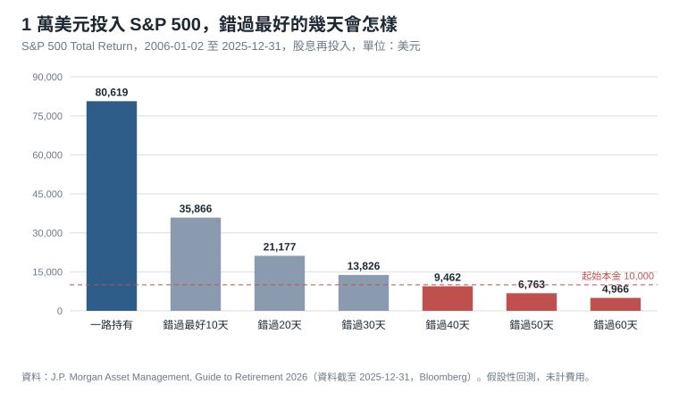
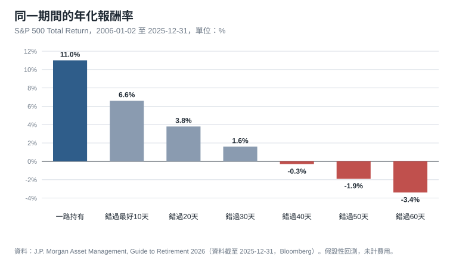
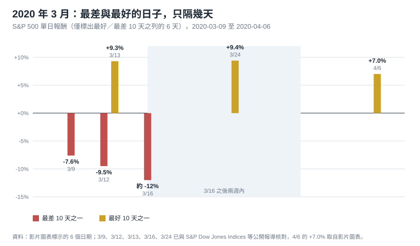
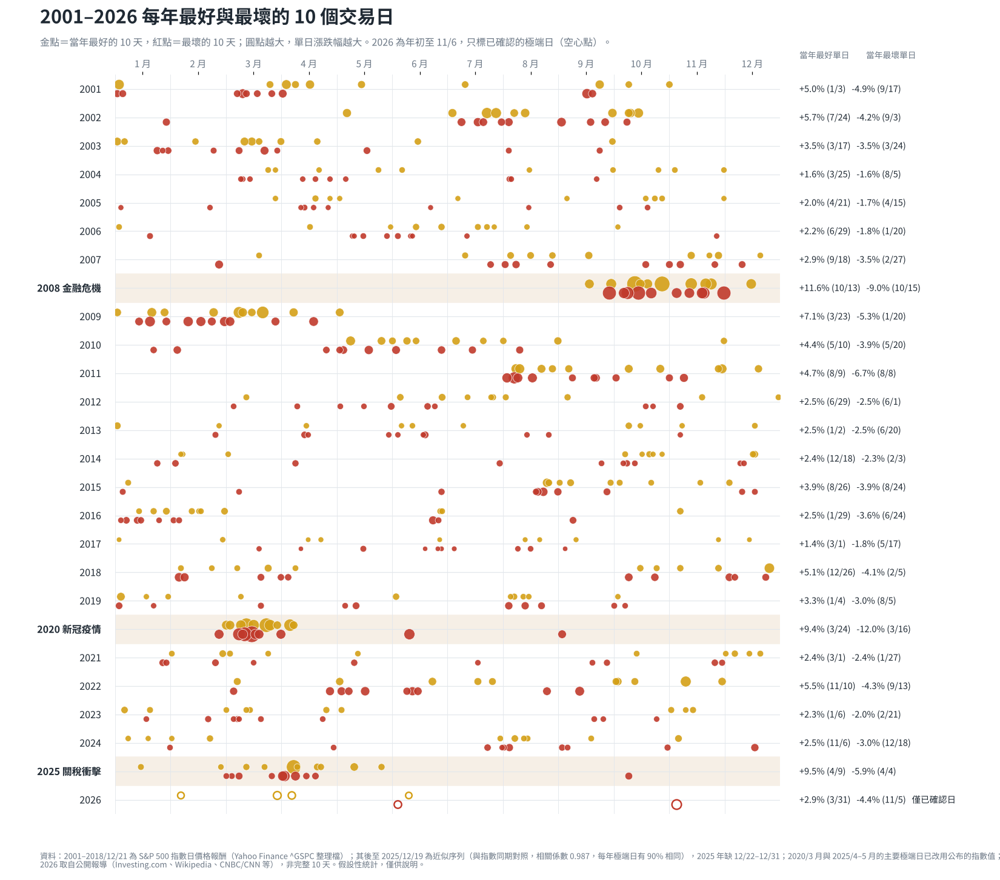
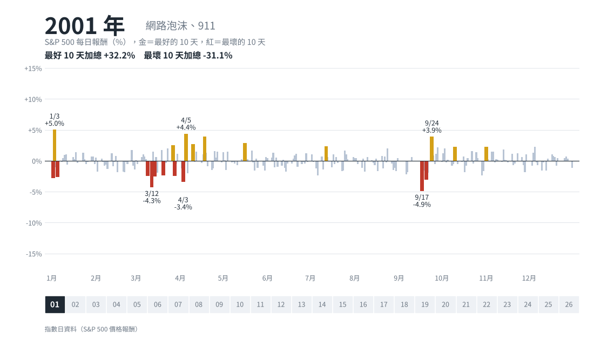
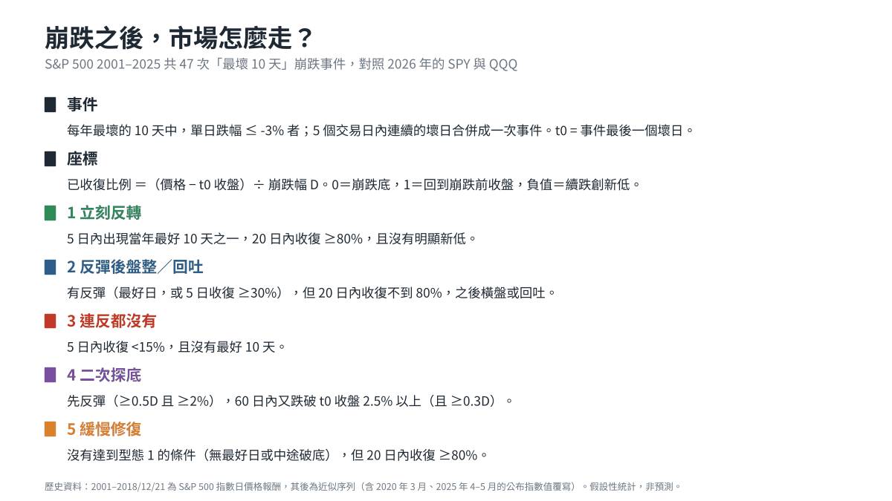

大跌當天，我看了一支美股複盤影片，講者用兩組東西勸觀眾別在最恐慌的那天做決定：一組是標普 500 歷史上最好與最壞的 10 天，另一組是四種機構面對下跌時各自遵守的規則。這篇照這個順序拆成兩個部分。第一部分回到原始資料，把最好與最壞的 10 天重畫一遍，並看崩跌之後市場通常怎麼走；第二部分談四種機構的思考模型，以及一般投資人站在這四種模型的哪個位置。 從挪威主權基金的再平衡規則學到的重要訊息是 **我的退出原則要在買入時先寫好了嗎？**

## 第一部分：最好與最壞的 10 天

先看一個說法：最壞的日子和最好的日子靠得很近，賣在恐慌裡，往往連反彈一起賣掉。

### J.P. Morgan 的數字：錯過最好的幾天

這組標普 500 歷史資料的源頭是 J.P. Morgan Asset Management 的《Guide to Retirement 2026》，涵蓋期間是 2006 年 1 月 2 日到 2025 年 12 月 31 日，指數是 S&P 500 Total Return（含股息再投入）：

- 1 萬美元一路持有，期末是 80,619 美元，年化 11.0%。
- 錯過最好的 10 天，剩 35,866 美元，年化 6.6%。
- 錯過最好的 40 天，剩 9,462 美元，比本金還少，年化 -0.3%。
- 最好的 10 天裡，有 6 天落在最差 10 天的兩週之內，其中 5 天出現在最差日之後。

常被引用的是「七天」，但這一版（2006 至 2025）原文是六天；七天是前一版（2005 至 2024）的數字。另一個常被一起引用的「間隔七天」是不同的統計：Morningstar 算過 1990 年到 2026 年 3 月，最差十天與最好十天之間的間隔中位數是七天，兩個「七」不是同一件事。而且六天是 20 年合併計算的結果，並不表示每個最好日都緊貼最差日。

要靠賣出避開下跌，你得在更恐慌的價位把部位買回來，這件事專業投資人也很少做得到。但這組統計是事後諸葛，Morningstar 的重算也發現，如果同時避開最差的 10 天，結果會比一直持有略好，兩邊大致互相抵消。所以，沒有人事先知道哪幾天是哪幾天。

### 2020 年 3 月：最差與最好，只隔幾天

*圖：S&P 500 單日報酬，只標出屬於最好或最差 10 天的 6 個日子。灰藍底為 3/16 之後的兩週。*

我覺得最有說服力的一張圖，是 2020 年 2 月到 4 月的每日報酬長條圖。把其中屬於最好或最差 10 天的 6 天挑出來，順序是這樣的：

- 3/9（週一）：-7.6%，這是當時第一次觸發熔斷的一天。
- 3/12（週四）：-9.5%，單日跌幅是 1987 年黑色星期一以來最大。
- 3/13（週五）：+9.3%，隔天就反彈，含息報酬是 +9.32%，是 2008 年 10 月以來最好的一天。
- 3/16（週一）：約 -12%，一個交易日後再創更大的跌幅。
- 3/24（週二）：+9.4%，在這之前一天（3/23）才是這一輪下跌的收盤最低點。
- 4/6（週一）：+7.0%。

這張圖要先看的是，最差和最好幾乎黏在一起。3/12 的 -9.5% 與 3/13 的 +9.3% 只隔一個交易日，3/13 的反彈和 3/16 的 -12% 之間又隔一個週末，所以波動本身就是市場的狀態，並沒有先跌完再漲的兩個階段。但這不表示每個最好日都緊貼最差日：三個最好日裡，3/13 和 3/24 分別在最壞日之後隔 1 個和 6 個交易日，4/6 則距 3/16 已經隔了 15 個交易日。

接著要看的是，在 3/16 賣掉不一定比後來買回更貴。3/16 之後隔天彈了約 6%，接著四個交易日又跌了約 11.5%，3/23 才是收盤底部，再隔天 +9.4%。所以 3/16 收盤賣掉、3/23 買回，事後看價格是更低的。問題是 3/23 要到收盤後才知道是底部，你得在 VIX 剛創下歷史新高的一週裡剛好選中那一天買回，選錯一天，就漏掉隔天的 +9.4%。賣出本身可以事後看起來很對，難的是第二個動作。

所以賣出不一定吃虧，問題是沒有事先寫好的規則時，賣出與買回兩個決定都得在最恐慌的時候即時做。

### 2001–2026：每一年的最好與最壞 10 天

*圖：金點是當年最好的 10 天，紅點是最壞的 10 天，圓點越大漲跌越大；GIF 逐年重播。*

把 2001 年到 2026 年每年最好與最壞的 10 天標在年表上，最醒目的特徵是群聚：2008 年 10 月到 12 月、2020 年 3 月到 4 月、2025 年 4 月，金點與紅點擠在同一個月份裡，其他年份則零散分布。最壞的日子和最好的日子常一起出現，集中在市場最不穩的那幾個星期。

### 崩跌之後怎麼走：五種型態

*圖：歷史 47 次崩跌事件的路徑（座標為已收復比例），以及 2026 年 SPY 與 QQQ 的逐月重播。*

接著的問題是：大跌之後，反彈會不會來、來得多快。我把 2001 到 2025 年每年最壞 10 天中單日跌幅達 3% 以上的日子找出來，5 個交易日內連續出現的合併成一次崩跌，共 47 次，再看每次崩跌最後一個壞日（t0）之後的路徑。衡量方式是「已收復比例」：價格從 t0 收盤回升多少，除以這次崩跌的幅度；0 代表還在底部，1 代表回到崩跌前的收盤。

47 次事件裡，符合「壞、壞、壞，然後好、好、大好，五天內掉頭」的只有 6 次（13%），例如 2020 年 3 月與 2025 年 4 月。多數事件走得比較拖：17 次（36%）在反彈之後又跌破 t0 收盤至少 2.5%，也就是二次探底；9 次（19%）連 5 天內像樣的反彈都沒有；另外 7 次（15%）反彈後卡住，8 次（17%）沒有最好 10 天等級的大漲日，卻在一個月內慢慢補回。

「最後有沒有漲回來」和「中途會不會再破底」是兩個問題，答案也不一樣：47 次事件中，60 個交易日後仍高於 t0 收盤的有 81%，但 60 日內曾經再跌破 t0 收盤 2.5% 以上的也有 60%。多數崩跌最後會漲回來，但途中再創新低很常見。

2026 年自己的崩跌事件，我用同一套規則重跑：SPY 在 3 月 27 日與 6 月 10 日兩次崩跌都屬立刻反轉，QQQ 同期的 6 月 5 日與 6 月 23 日兩次則是二次探底。

10 月 30 日到 11 月 5 日這一次還在進行中：11 月 5 日 SPY 單日下跌約 4.3%、QQQ 約 6.3%，11 月 6 日分別反彈 0.3% 與 1.3%，尚未出現當年最好 10 天等級的大漲日。歷史上開局相似（第 1 天沒有大好日，且只收復崩跌幅 30% 以下）的有 31 次，後續分布是二次探底 35%、連反都沒有 23%、緩慢修復 19%、反彈後盤整 13%、立刻反轉 10%。

## 第二部分：四種機構的思考模型

第一部分說明為什麼不能靠猜哪一天是底。專業機構的做法，是把「不猜」寫成規則，而四種機構寫下的規則並不相同。

### 四種機構，四個不同的觸發條件

我的核心觀察是：同一天暴跌，四類機構的動作可以完全相反，因為各自盯的東西不一樣。

多基金經理平台（影片以 Millennium 為例）盯的是**虧損線**。依講者的說法，單一經理虧到某個幅度，可動用的資金就被砍半，再虧一段就被請走，資產的邏輯還在不在，風控部門不問。價格碰到停損，就走。

基本面多空基金盯的是**論點**。生意與邏輯支柱沒變，價格下跌只是加倉的理由；邏輯變了，不管價格多少都該賣。

主權基金、養老金與只做多的指數型投資人盯的是**權重**。股票占比漲出或跌出目標區間，就買回或賣回目標比例。

系統性資金（CTA、波動率目標基金）盯的是**波動**。波動越大，倉位越小，好讓單一部位對整個帳戶的衝擊維持在可控範圍。這一格常伴隨衍生品與槓桿。

講者自己的做法是第二格與第三格的混合，後面再談。

### 小字註腳指向哪裡

投影片底部的小字標了兩份出處，都來自 NBIM（挪威央行的投資管理部門）：2012 年的 Management of the Government Pension Fund Global，以及 2018 年 8 月 28 日給財政部的再平衡信。前者標題較籠統，從內容判斷最可能是 2012 年 1 月 26 日那封再平衡規則建議信，書目見文末資料來源。

### 2012：先把規則寫成公開的

2012 年那封信的主旨，是讓再平衡從一個「偶爾發生、後果重大的特別決定」變成日常管理的一部分。信裡的主張大致有四條：

- 再平衡規則應該寫進財政部給央行的公開 mandate，做到簡單、可預測、可驗證。
- 再平衡改以股票這個資產類別為準，不再綁固定的地區權重。
- 採用條件觸發制，而不是固定日曆。信裡回顧，基金自 2001 年底改制後，完整再平衡只發生過兩次，分別在 2003 年與 2009 年。
- 廢除隨每月資金流入而微調基準指數的「部分再平衡」，理由是這種做法讓基準指數複雜難驗證，而且 NBIM 自己的歷史分析顯示它對報酬與風險的取捨有負面影響。

具體數字上，當時的策略股票比重是 60%。NBIM 建議股票占比偏離 3 個百分點就在季末回到目標，財政部最後採用的是偏離 4 個百分點、月底檢查的版本。

信裡也提到：**固定資產權重不等於固定風險**。股價大跌之後把股票買回原本的比重，投資組合的絕對風險反而會上升，因為此時市場的不確定性通常更高。NBIM 的立場是，這是一個長期投資人才做得到的逆勢動作，並且認為再平衡本身（而不是觸發門檻設在哪裡）才是影響風險報酬取捨的關鍵。

### 2018：基金變大之後，規則得跟著改

六年之後，策略股票比重從 60% 升到 70%，基金規模從約 3,400 億克朗變成約 8,500 億克朗。一旦觸發再平衡，要買賣的金額大得多；信裡提到，金融危機之後要在不推動市價的情況下做大額交易，已經變得比以前更困難。

NBIM 的建議因此是兩個方向同時調整：觸發區間縮窄到正負 2 個百分點，回到目標的速度放慢，分更長的時間、每月較小的金額去做。依他們的歷史資料分析，這個組合能同時降低交易成本與偏離目標的程度。

這封信還有一個結論，和「跌多了買、漲多了賣」的直覺有出入。NBIM 檢驗過簡單的、以報酬為依據的再平衡規則能不能抓到股票風險溢酬隨時間的變化，結論是不太可能。所以在它的分析裡，這類規則的價值主要在控制風險與成本，很難靠它擇時賺超額報酬。如果想做後者，需要看已實現報酬以外的指標，也需要重新劃分財政部與央行的職責。財政部後來是否採納 2018 年的建議，這裡沒有查證。

### 把兩個極端放在一起看

挪威這一格和 CTA 那一格，剛好站在暴跌那天的兩端。

主權基金的規則是：跌多了，股票占比低於區間，就買。CTA 的規則是：波動放大，倉位按比例縮小，就賣。兩者都是紀律，兩者在同一天做的卻是相反的事。差別在於它們各自有不同的承受能力：主權基金沒有槓桿、沒有贖回壓力、投資期限以數十年計；波動目標基金是為了讓帳戶層級的風險維持恆定而設計的。

### 一般投資人站在哪裡

四種機構有一個共同點：決定在冷靜的時候就寫好，崩跌那天只負責執行。機構做得到，是因為制度把「寫規則的人」和「照做的人」分開了。挪威主權基金最清楚：財政部在 mandate 裡決定再平衡的區間，Norges Bank 負責執行，執行的人不必在崩跌當天重新辯論一次。

一般散戶買家沒有這個分工，同一個人要同時當財政部和央行。平靜的時候你是訂規則的人，崩跌那天你是執行的人，而執行的人在最恐慌的時候，偏偏最想推翻規則。第一部分的資料說的就是這件事：沒有事先寫好的規則，賣出與買回兩個決定都會變成情緒。

有一個簡單的檢驗方法：假設手上這個虧損的部位現在是現金，你會不會用今天的價格再買一次？答案是會，成本價就不該影響決策；答案是不會，那最初的買入理由大概就不穩；答案是不知道，那代表手上有倉位，卻沒有規則。

把四種模型搬到一般散戶身上，各自卡在不同的地方。短線交易者對應多基金經理平台：機構有風控部門替經理按下停損，散戶沒有人替自己按，停損線設了，也可能在當天被自己取消；而且像 3 月 16 日那種日子，停損一旦被打到，不到八個交易日就是 +9.4% 的反彈。挑個股的人對應基本面多空基金：機構靠研究團隊持續追蹤論點，散戶做不到，但上面那個「如果現在是現金，你還買不買」的問題，是同一套邏輯的簡化版，一個人也問得出口。三倍 ETF 與選擇權玩家對應系統性資金：後者靠波動換算倉位，需要槓桿和執行系統，講者的說法是散戶沒有這種軍備競賽的條件，而且常常做出相反的事，波動越大，越想加槓桿把虧損追回來。

四種裡面，散戶最容易照做的，是主權基金那一格的權重再平衡：不需要預測，也不用追蹤公司，只要事先決定每個部位占多少、偏離多少就調回來。區間與調整速度怎麼設，可以參考前面 NBIM 2018 年的做法（但那是針對它自己的基金規模得出的結論，散戶的成本結構不同）。

講者自己的做法，是把基本面那一格的「論點壞了才賣」和主權基金那一格的「權重超出區間才調」疊在一起：買入時寫下退出條件，之後只有兩件事會觸發動作，一是論點失效，二是權重偏離，其餘時候價格本身不構成理由。10 月底 NVDA 因為超過目標權重而減倉、黃金因為低於目標權重而加碼，就是這個組合的實例，兩個動作都和他對短期走勢的看法無關。它把散戶最容易犯的兩個錯，恐慌賣出和加槓桿追回，排除在規則之外。

## 說明與限制

本文的統計都是歷史資料的條件統計，不是預測，也不是投資建議；每個人的資金期限與風險承受度不同，規則要依自己的情況調整。年表與崩跌型態的資料：2018 年 12 月 21 日以前是指數日資料，之後到 2025 年 12 月 19 日是近似序列（部分關鍵日改用公布的指數值），2026 年的 SPY 與 QQQ 來自我的 _cute-datafeeder，年表上只標已確認的極端日。五種型態的分類門檻是我自己設定的，換一組門檻，各型態的占比會變；開局相似的歷史事件只有 31 次，事件之間也不是獨立的。

## 資料來源

- Norges Bank, 〈Government Pension Fund Global – rules for rebalancing the benchmark index〉，給財政部的信，2012 年 1 月 26 日（nbim.no，Submissions to ministry / 2012）；投影片標示的 2012 年出處標題較籠統，此信為最可能的對應，同年 4 月另有同名的國會聽證簡報
- Norges Bank, 〈The rule for rebalancing the equity share in the Government Pension Fund Global〉，給財政部的信，2018 年 8 月 28 日（nbim.no，Submissions to ministry / 2018，PDF 全文可下載）
- Yngve Slyngstad, 〈Management of the Government Pension Fund Global (GPFG)〉，國會財委會聽證開場陳述，2013 年 4 月 30 日（說明財政部採用月底偏離 4 個百分點的規則）
- J.P. Morgan Asset Management, Guide to Retirement 2026（slide GTR 41, "Impact of being out of the market"；資料截至 2025-12-31）
- Morningstar, "You can beat the stock market by avoiding its worst days. But you won't"（最差與最好十天間隔中位數為七天）
- S&P Dow Jones Indices 對 2020 年 3 月 12、13 日報酬的報導；A Wealth of Common Sense, "A Look Back at the Corona Crash One Year Later"（3/9、3/12、3/13、3/16、3/23 的走勢）
- 原影片：youtube.com/watch?v=_HScTwPnpXU（四類機構的描述與 Millennium 的虧損線數字皆為講者說法，未另行查證）
- 崩跌型態與年表：2001–2018 年 S&P 500 指數日資料（Yahoo Finance ^GSPC 整理檔）、2019–2025 年近似序列；2026 年 SPY 與 QQQ 日線來自作者的 _cute-datafeeder；型態分類門檻為本文設定
