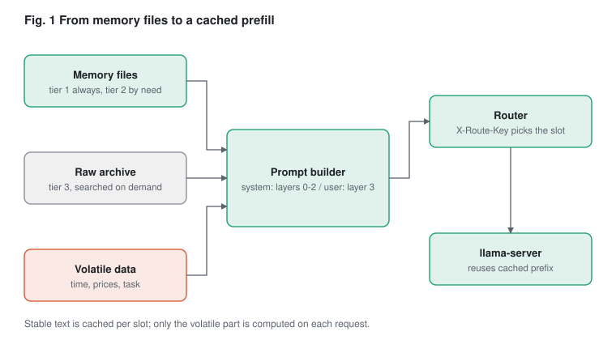
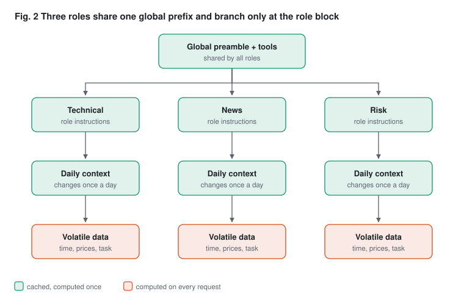
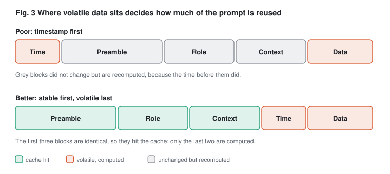
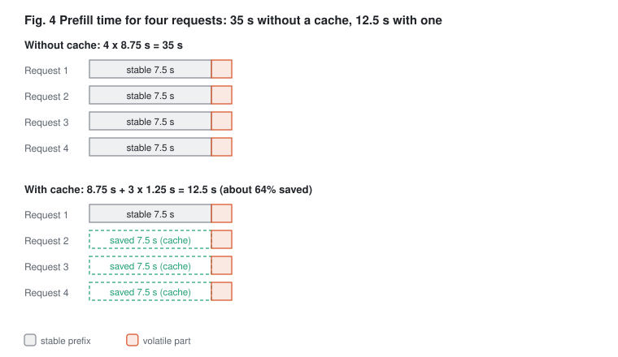

# Agent Memory, Prefix Caching and Prompt Pre-processing: A Worked Design

Date: 2026-11-12

## 引言 Introduction

當某種風格的圖片生成突然流行,例如吉卜力風,成千上萬的人會送出幾乎一樣的請求:同樣的風格指令,只換一張照片。對推論服務來說,這代表同一段前綴被反覆計算。2025 年 3 月吉卜力風圖片流行時,OpenAI 執行長 Sam Altman 就說過 GPU 快被燒壞了([TweakTown](https://www.tweaktown.com/news/104282/studio-ghibli-style-ai-images-are-melting-openais-gpus-confirms-sam-altman/index.html))。多人同時使用時,問題不在「算得夠不夠快」,而在「同樣的東西是否被算了太多次」。

雲端推論引擎面對的是同樣的多發情境,瓶頸有兩種,性質不同。prefill 階段一次讀入整段提示詞,是運算量的問題;decode 階段一個字一個字生成,每一步都要讀取模型權重和已存的 KV cache,卡在記憶體頻寬,也就是所謂的 memory wall。請求一多,KV cache 還會占滿顯示記憶體。所以雲端引擎做了連續批次處理、分頁式 KV cache 管理,並把 prefill 和 decode 拆到不同機器上,各自用適合的方式擴充。

SGLang 等新引擎再往前一步:既然很多請求的開頭一樣,就不要重算。SGLang 的 RadixAttention 用一棵 radix tree 記住已算過的前綴,共用前綴的請求共用同一份 KV cache;HiCache 再把快取分層放到主機記憶體與共享儲存。vLLM 的自動前綴快取、LMCache 的跨機共享,以及 NVIDIA Dynamo 的 KV 感知路由,方向也相同:把請求導向已有快取的地方。

我們的借鏡是,本機只有一台 M1 Pro、一個跑著 `-np 8` 的 llama-server,沒有這些雲端機制,但同一個原則可以搬到應用層來做。第一,提示詞分層,穩定的內容放前面,時間、價格這類每次都變的資料放最後。第二,記憶系統只挑選並固定要載入的內容,讓前綴不會因為措辭改變而失效。第三,用角色標記讓每個角色固定走同一個 slot。先量測重複計算的比例,再決定值不值得改。

## Overview

Three pieces cut repeated work in a multi-agent stack: a small memory system that decides what text enters the prompt, a prompt builder that puts stable text first, and an inference setup that reuses the cache for that stable text. Each piece only pays off together with the other two.

- **Memory system**: short facts in files, detail kept elsewhere, a fixed set of always-loaded files. This sets what the stable prefix contains.
- **Prompt pre-processing**: layer the prompt as global, role, context, then volatile data, with deterministic text. This sets where the prefix ends.
- **Inference engine**: prefix caching (SGLang RadixAttention, vLLM-style APC) or, on llama-server, slot pinning plus a router. This makes the prefix cost one prefill instead of one per request.



*Fig. 1  From memory files to a cached prefill. Memory files, archive hits and volatile data all pass through the prompt builder. The router then sends each role to a fixed slot, and the engine computes only the volatile part.*

A KV cache is only valid for the same model, build, quantization and context settings, and standard prefix caching needs a token-exact prefix. One changed token early in the prompt breaks reuse for everything after it. That single rule drives all three designs below.

The example numbers are assumptions for a prefill speed of 400 tokens per second, not measurements. Measure your own stack first (section 4).

## 1. Example memory system

Keep memory as short, dated facts in small files, and keep the raw detail in a separate store that is searched on demand. A summary is a lossy copy, so every summary line should say where the detail lives.

### Tiers

| Tier | What it holds | Loaded when | Where it lives |
|---|---|---|---|
| 0 System prompt | Role, rules, output format | Every request | Prompt builder, global layer |
| 1 Profile and preferences | Who the user is, how to behave | Every request | /profile.md, /preferences.md |
| 2 Topic and area files | One subject per file, short facts | When the listing says it is relevant | /topics/, /areas/, /people/ |
| 3 Raw archive | Full logs, transcripts, documents | Only by search or explicit read | SSD folder, database, vector index |

The context window is fixed by the model, so tiers 0 and 1 must stay small and stable. Tiers 2 and 3 are pulled in per task and belong in the volatile or context layer, never in the global layer.

### File layout

```text
memory/
  profile.md            tier 1, under 300 words
  preferences.md        tier 1, how the agent should behave
  areas/
    alpaca-trading-agent.md   tier 2, one ongoing project per file
  topics/
    investing.md              tier 2, facts by domain
  people/
    <name>.md                 tier 2, relationship context only
  archive/                    tier 3, never auto-loaded
    2026-11/session-0412.jsonl
    index.sqlite               full-text index over the archive
```

### Sample files

```markdown
---
name: areas/alpaca-trading-agent
description: LLM signal generation and Alpaca execution; read for design decisions and open issues
sources: [chat]
aliases: [AlpacaTradingAgent]
---
- [stated] Runs llama-server with 8 slots; roles are technical, news, risk
- [stated] Wants fewer repeated prefills across roles
- [stated] Decision: move timestamps and prices after the role block
- detail: archive/2026-11/session-0412.jsonl (full discussion)
```

```markdown
---
name: preferences
description: How the user wants the agent to work, applies to every task
---
- [stated] Reply in the language of the latest message
- [stated] Prefers working scripts over explanations
```

### Write rules

1. One fact per line, tagged with its origin (`[stated]` for what the user said). Never store your own conclusions as the user's facts.
2. One subject per file. A fact about X goes only in X's file.
3. Update a line instead of appending a contradicting one.
4. Put a pointer (`detail: <path>`) on any line whose full story is in the archive.
5. Skip facts that expire on their own, such as a branch name or a port.

### Read rules

1. Load tiers 0 and 1 on every request, in a fixed order, from a deterministic render (see section 3).
2. Load the file listing (names and one-line descriptions) as the index. Read a file only if its description says this request needs it.
3. To recover detail, follow the `detail:` pointer or run a search over the archive. Do not ask the model to reconstruct it from the summary.

### Moving memory between agents

Files move as plain text and work anywhere. What differs per agent is how it summarizes, indexes and loads them, so the same files give different results on different agents. For a controlled move, send the tier 0 and 1 files verbatim into the new agent's system prompt, and let it index tiers 2 and 3 itself.

## 2. Improving the inference engine

Prefix caching stores the computed attention state (KV cache) for text already seen, and reuses it when a new request starts with the same tokens. Only the part after the first difference is computed again. Decode time does not change.



*Fig. 2  Three roles share one global prefix and branch only at the role block. All three roles share the first block, so the engine computes it once. The volatile blocks at the bottom are computed on every request.*

### How engines do it

- **SGLang RadixAttention**: a radix tree on the CPU whose keys are token sequences and whose values are KV tensors on the GPU. Shared prefixes share nodes, a node splits where two prompts diverge, and least recently used leaves are evicted first. HiCache extends this to host memory and shared storage.
- **vLLM Automatic Prefix Caching**: hashes fixed-size token blocks and reuses blocks with the same hash chain. LMCache adds sharing across processes or machines.
- **llama.cpp (llama-server)**: each slot keeps its own KV cache. A request that lands on a slot whose cache starts with the same tokens skips that prefix. There is no cross-slot tree, so which slot a request lands on decides the result.
- **Snapshots**: llama-server can save and restore a slot to disk (`--slot-save-path`, `/slots/{id}?action=save|restore`). The hearth proxy builds on this to keep caches across restarts; its benchmark reports a 30k-token follow-up dropping from 99 s to 1.8 s.

No formal standard for exchanging KV caches exists. A cache is tied to one model build, so any shared format would need a manifest (model identity, prefix hash, geometry, version) around each engine's own payload.

### Emulating prefix caching on llama-server

| Approach | What it does | Cost | Best when |
|---|---|---|---|
| Slot pinning per role | Send each role always to the same slot via `id_slot` | One field per request | Few, fixed roles |
| Router | Pick the slot whose last prompt shares the longest prefix, or use a key header | A small proxy (`prefix_router.py`) | Many callers, no code changes in them |
| Snapshot seeding | Prefill the stable prefix once, save it, restore it into other slots | Disk space, restore time | Same prefix across many slots or restarts |
| Mini prefix tree | Track prefixes by builder hashes and manage slots like a tree | Most code | More roles than slots |

### The router in practice

`prefix_router.py` sits in front of `llama-server -np N` and adds `id_slot` and `cache_prompt: true` to each chat or completion request.

```text
python3 prefix_router.py --upstream http://127.0.0.1:8080 --slots 8 --port 8791
```

- With the header `X-Route-Key: <role or stable_sha>`, the same key always gets the same slot.
- Without it, the router picks the slot whose last prompt covers at least 80% of the new prompt, else a never-used slot, else the least recently used one. This guess is reliable only when the volatile part is small.
- A request that sets `id_slot` itself is left alone. `GET /_router/stats` shows hits per slot.

In a test against a fake server with three roles, each role stayed on one slot and about 99% of each prompt was reused from round two on. A real llama-server has not been tested here; confirm that your build honours `id_slot` by watching `timings.cache_n` grow for repeated prefixes.

### Other ways to avoid duplicate work

- **CacheBlend** (EuroSys 2025) reuses cached chunks that are not prefixes and recomputes about 10 to 15 percent of tokens. It is approximate, so check output quality before using it.
- **Disaggregated prefill and decode** (NVIDIA Dynamo, LMCache) moves KV between GPUs. It targets multi-GPU servers, not a single M1 Pro.

## 3. Prompt pre-processing

Build every prompt in layers, most stable first, and render each layer deterministically. Then the cache can reuse the longest possible start, and the engine needs no changes to benefit.



*Fig. 3  Where volatile data sits decides how much of the prompt is reused. In the poor layout the time at the front changes on every request, so everything after it is recomputed. With stable text first, only the last two blocks are new.*

### Layers

| Layer | Content | Changes | Where it goes |
|---|---|---|---|
| 0 Global | Preamble, rules, tool definitions | Rarely | System message, first |
| 1 Role | One block per analyst role | Rarely | System message, after global |
| 2 Context | Daily watchlist, settings, memory tier 1 and 2 facts | Daily | System message, last |
| 3 Volatile | Timestamp, prices, news, the task itself | Every request | User message |

Chat templates usually render tools first, so tool definitions belong to layer 0 and must be byte-identical between calls.

### Determinism rules

1. Normalize text: Unicode NFC, `\n` newlines, no trailing spaces, at most one blank line.
2. Sort tool lists by name and JSON keys alphabetically, with the same separators every time.
3. Render dictionaries with a fixed key order.
4. Keep timestamps, prices, counters and random IDs out of layers 0 to 2.
5. Never reorder layers per request, and never insert per-request text between them.

### Worked example

```python
from prompt_builder import PromptBuilder
import datetime

pb = PromptBuilder(PREAMBLE, tools=TOOLS, forbidden_terms=("advice",))
pb.add_role("technical", TECH_TEXT).add_role("news", NEWS_TEXT)

req = pb.build(
    "technical",
    context=watchlist_text,                 # layer 2, daily
    now=datetime.datetime.now(),            # layer 3
    volatile={"AAPL": "189.42"},            # layer 3
    task="Assess the BB%B / Two-Pole signal.",
)
payload = {"model": MODEL, "messages": req["messages"]}
if req["tools"]:
    payload["tools"] = req["tools"]
# req["meta"]: global_sha, role_sha, context_sha, stable_sha, warnings
```

The result is one system message (global, role, context) and one user message (time, data, task). `meta.stable_sha` is a fingerprint of everything that should be cached; if it changes between two calls of the same role, something volatile leaked into a stable layer.

### Lint

The builder warns once per distinct problem when it sees date-like, time-like or price-like text in layers 0 to 2 (a daily date in the context layer is allowed), and when a forbidden term appears in any layer. Log `meta.warnings` and fix the source text.

### What it changes

On synthetic prompts (3 roles, 30 requests, a window of the last 8), the share of each prompt that matched an earlier prompt as a prefix was:

| Layout | Average reusable prefix |
|---|---|
| Timestamp first, data in the middle | 6.4% |
| Layered, volatile data last | 96.8% |

These prompts are artificial, with a long stable part and a short volatile part. Real prompts will land lower when the volatile part is large; measure yours (next section).

### Using memory in the layers

Put tier 1 files (profile, preferences) in layer 0 or 1 so they stay cached. Put tier 2 files chosen for this task in layer 2. Put anything searched from tier 3 in layer 3. The more a memory fact changes, the later it goes.

## 4. End-to-end flow and measuring

Measure the duplicated prefill first, change the prompt layout second, pin slots third. Each step has a check that tells you whether it worked.

### Flow of one request

1. The agent selects memory: tier 1 files always, tier 2 files whose descriptions match the task, tier 3 only by search.
2. `prompt_builder` renders layers 0 to 2 into the system message and puts time, data and task in the user message.
3. The request goes to `prefix_router.py` (or straight to a server with automatic prefix caching), with `X-Route-Key` set to the role.
4. The engine finds the longest cached prefix in that slot, computes only the rest, and decodes the answer.
5. The proxy or logs record `timings.cache_n` and `prompt_n` so the next run can be compared.

### Step 1: measure the waste

```text
python3 kv_dup_tap.py serve --upstream http://127.0.0.1:8080 --port 8790
python3 kv_dup_tap.py report --log kvdup.jsonl
```

Point the agents at port 8790 for a normal working session. The report gives the cache hit rate, the tokens that could have been avoided, an estimate in seconds, per-family tables and the places where prompts first diverge (digits masked). A result of 25% avoidable or more means the work is worth doing; below 5% it is not.

### Steps 2 and 3: change layout, then pin

Rebuild prompts with `prompt_builder.py`, add `X-Route-Key`, and run the same session again through the tap. Compare the two reports.

### Expected gain

Prefill time without a cache is N x (P + V) / r. With one cache per slot it is (S x P + N x V) / r. Here P is stable tokens, V is volatile tokens, N is requests, S is slots or roles and r is prefill speed.



*Fig. 4  Prefill time for four requests: 35 s without a cache, 12.5 s with one. Without a cache every request pays the stable 7.5 s again. With a cache only the first request does, so four requests take 12.5 s instead of 35 s, about 64% less.*

| Scenario (r = 400 tokens/s, N = 200, S = 3) | Without cache | With cache | Saved |
|---|---|---|---|
| A: P = 3000, V = 500 | 1750 s | 272.5 s | about 84% |
| B: P = 300, V = 3000 | 1650 s | 1502 s | about 9% |

r is an assumed speed, not a measurement. The saving depends on how long the stable part is compared with the volatile part, which is why the first step is to measure.

## 5. Speculative decoding and MTP: one model or two?

Prefix caching speeds up prefill. Speculative decoding speeds up decode, so the two are separate levers. In both forms below, the big model checks the guessed tokens in one parallel pass and keeps the longest correct prefix.

| | Classic draft-model speculation | MTP (multi-token prediction) |
|---|---|---|
| Models loaded | Two: a small draft model and the target | One: the target, with an extra prediction head in its own file |
| How drafts are made | A full forward pass of the small model | The target's hidden state feeds the extra head, which predicts the next few tokens |
| Requirement | Any target, plus a draft from the same family | The model must be trained with MTP heads (for example Qwen3.6) |
| Setup | Second model file and its memory | One flag; in vLLM `{"method": "mtp", "num_speculative_tokens": 1}` |

So two models cooperate only in the classic form. With MTP the "draft" is part of the same model. The exception found is Gemma 4 in vLLM, where a separate assistant checkpoint is passed in but treated as an MTP component.

What it means for this stack (llama-server on an M1 Pro, several slots):

- One llama.cpp test at 128K context (a single workload) reported decode 90 to 95 tokens/s (about 5% faster) but prefill 3,840 to 2,978 tokens/s (about 22% slower). A prefill-heavy multi-role stack may lose more than it gains.
- The same source says `nParallel > 1` and `--cache-reuse` are silently disabled when MTP is on. That would undo slot pinning and prefix reuse. Whether draft-model speculation has the same limit in llama-server has not been checked.
- Recommendation: do prefix caching first (sections 2 to 4). Consider MTP only if decode speed becomes the bottleneck, and test it with your slot setup first.

### Picking one method automatically

If you are not sure whether a model has an MTP head, read the model file instead of guessing. `spec_probe.py` does this and chooses exactly one method (`mtp`, `draft` or `off`), so no second drafter is loaded and no extra overhead is added.

```text
python3 spec_probe.py MODEL.gguf --draft DRAFT.gguf --slots 8 --server-bin /path/to/llama-server
```

- **GGUF:** an MTP head shows as a `*nextn_predict_layers` metadata key above 0, or tensor names containing `nextn`.
- **Hugging Face:** a key containing `nextn` or `mtp` with a value above 0 in `config.json`.
- **Auto rule:** MTP head and one slot gives `mtp`. A draft model given gives `draft` (flags `-md <path> --draft-max 8`). An MTP head with several slots gives `off`, because MTP reportedly disables parallel slots and `--cache-reuse`; `--mode mtp` forces it. Otherwise `off`.
- **MTP flag name:** it differs between builds, so with `--server-bin` the script lists the MTP options from that build's `--help` instead of guessing.

Tested only on synthetic GGUF and `config.json` files, not on a real model or a real llama-server build.

Running MTP and a draft model together is not a standard setting in the engines checked, and MTP's high acceptance rate (about 75 to 90% reported) leaves little for a second drafter to add.

## 6. Where it belongs in AlpacaTradingAgent, and a single class

Put the memory pre-processing in the app (option c). Put only slot pinning in the pre-router (option a). Keep memory out of the engine (option b).

| Part | What it does | Why there |
|---|---|---|
| c. App (AlpacaTradingAgent, called from `llm_client.py`) | Loads memory files, builds the layered prompt, lints it, sets `X-Route-Key` | Only the app knows the roles, the forbidden word, the CoT preamble and which data is volatile. Every model is endpoint-agnostic (local or remote), so a prompt built here works on any of them |
| a. Pre-router patch | Reads `X-Route-Key` and pins the role to one slot | Generic and engine-facing, but it needs no knowledge of memory. Its slot count must match `-np 8` and the app's `asyncio.Semaphore` |
| b. Engine (for example MTPlm) | Prefix cache and speculative decoding | An engine that understands memory stops being swappable. Keep it content-agnostic |

I do not know what MTPlm is in your stack, so the row above treats it as any inference engine.

Two things to check in the existing code, which I have not seen:

- `_inject_datetime()` in `llm_client.py`: if it puts the date or time at the start of the system message, it breaks the shared prefix on every request. Move it into the user message (layer 3).
- `--cache-reuse 0` in the recommended llama-server config: as far as I know this turns off KV-shifting reuse, not the basic reuse of a slot's own prefix. Confirm with `timings.cache_n` on a repeated prefix.

### The class

One class, standard library only. Roles, preamble and the forbidden word come from the app.

```python
import datetime
import hashlib
import json
import logging
import re
import unicodedata
from pathlib import Path


class PromptMemory:
    """Memory files -> cache-friendly prompt, in one class (stdlib only).

    Layers, most stable first:
      system message: preamble + tier-1 memory (all roles) | role block | tier-2 context
      user message  : time, volatile data, task
    Also returns an X-Route-Key header so a slot router can pin each role.
    """

    _VOLATILE = (("date", re.compile(r"\b\d{4}-\d{2}-\d{2}\b")),
                 ("time", re.compile(r"\b\d{1,2}:\d{2}(?::\d{2})?\b")),
                 ("price", re.compile(r"[$＄]\s?\d[\d,]*\.\d+|\b\d+\.\d{2,}\b")))
    _FRONT = re.compile(r"\A---\n(.*?)\n---\n?", re.S)
    log = logging.getLogger("prompt_memory")

    def __init__(self, root, preamble, roles, tools=None, forbidden=(),
                 tier1=("profile.md", "preferences.md"),
                 tier2_dirs=("areas", "topics"), max_context_chars=3000):
        self.root, self.tier1_files, self.tier2_dirs = Path(root), tier1, tier2_dirs
        self.max_context = max_context_chars
        self.forbidden = tuple(forbidden)
        self.preamble = self._norm(preamble)
        self.roles = {k: self._norm(v) for k, v in roles.items()}
        # same tools -> same bytes: sorted keys, list sorted by function name
        t = json.loads(json.dumps(tools, sort_keys=True)) if tools else None
        self.tools = sorted(t, key=lambda x: (x.get("function") or {}).get("name", "")) if t else None
        self._tools_json = json.dumps(self.tools, sort_keys=True, ensure_ascii=False) if t else ""
        self._frozen, self._warned = {}, set()
        self.refresh()

    # ---- memory loading -------------------------------------------------
    @staticmethod
    def _norm(text):
        t = unicodedata.normalize("NFC", text or "").replace("\r\n", "\n").replace("\r", "\n")
        return re.sub(r"\n{3,}", "\n\n", "\n".join(l.rstrip() for l in t.split("\n"))).strip()

    def _read(self, path):
        text = self._norm(path.read_text(encoding="utf-8")) + "\n"
        meta, m = {}, self._FRONT.match(text)
        if m:
            for line in m.group(1).split("\n"):
                if ": " in line:
                    k, v = line.split(": ", 1)
                    meta[k.strip()] = v.strip()
            text = text[m.end():]
        return meta, self._norm(text)

    def refresh(self):
        """Re-read memory files. Call when files change (e.g. once a day); it also
        unfreezes the tier-2 choice, so the cached prefix is rebuilt on purpose."""
        bodies = [self._read(self.root / f)[1] for f in self.tier1_files if (self.root / f).exists()]
        self._tier1 = "\n\n".join(b for b in bodies if b)
        self._index = []
        for d in self.tier2_dirs:
            for p in sorted((self.root / d).glob("*.md")):
                meta, body = self._read(p)
                key = " ".join((p.stem, meta.get("description", ""), meta.get("aliases", "")))
                self._index.append((p.relative_to(self.root).as_posix(), set(re.findall(r"\w+", key.lower())), body))
        self._frozen.clear()

    def _select(self, role, task, files):
        if files is not None:
            chosen = [e for e in self._index if e[0] in files]
        else:
            words = set(re.findall(r"\w+", (role + " " + task).lower()))
            scored = sorted(((len(words & e[1]), e) for e in self._index), key=lambda s: (-s[0], s[1][0]))
            chosen, used = [], 0
            for score, e in scored:
                if score and used + len(e[2]) <= self.max_context:
                    chosen.append(e)
                    used += len(e[2])
        return "\n\n".join(e[2] for e in sorted(chosen))  # fixed order by path

    # ---- prompt building ------------------------------------------------
    def build(self, role, task="", volatile=None, now=None, history=None, files=None):
        if role not in self.roles:
            raise KeyError("unknown role %r (known: %s)" % (role, sorted(self.roles)))
        day = now.date().isoformat() if hasattr(now, "date") else ""
        key = (role, day, tuple(files) if files is not None else None)
        if key not in self._frozen:  # same role, same day -> same context -> same prefix
            self._frozen = {k: v for k, v in self._frozen.items() if k[1] == day}
            self._frozen[key] = self._select(role, task, files)
        ctx = self._frozen[key]
        glob = "\n\n".join(p for p in (self.preamble, self._tier1) if p)
        system = "\n\n".join(p for p in (glob, self.roles[role], ctx) if p)

        vol = []
        if now is not None:
            vol.append("Now: " + (now.strftime("%Y-%m-%d %H:%M:%S") if hasattr(now, "strftime") else str(now)))
        for k in sorted(volatile or {}):
            v = volatile[k]
            vol.append("%s: %s" % (k, v if isinstance(v, str) else json.dumps(v, sort_keys=True, ensure_ascii=False)))
        if task:
            vol.append(self._norm(task))
        user = "\n\n".join(vol)

        warnings = self._lint([("global", glob, ()), ("role", self.roles[role], ()), ("context", ctx, ("date",))], user)
        sha = lambda s: hashlib.sha1(s.encode("utf-8")).hexdigest()[:10]
        return {"messages": [{"role": "system", "content": system}, *(history or []), {"role": "user", "content": user}],
                "tools": self.tools,
                "headers": {"X-Route-Key": role},  # lets a router pin the role to one slot
                "meta": {"role": role, "stable_sha": sha(system + self._tools_json),
                         "stable_chars": len(system), "volatile_chars": len(user), "warnings": warnings}}

    def _lint(self, layers, user):
        out = []
        for name, text, skip in layers:
            for kind, rx in self._VOLATILE:
                m = kind not in skip and rx.search(text)
                if m:
                    out.append("%s-like text in the %s layer: %r" % (kind, name, m.group(0)))
            for term in self.forbidden:
                if term and term in text:
                    out.append("forbidden term %r in the %s layer" % (term, name))
        for term in self.forbidden:
            if term and term in user:
                out.append("forbidden term %r in the volatile layer" % term)
        for w in out:
            if w not in self._warned:
                self._warned.add(w)
                self.log.warning(w)
        return out
```

Usage:

```python
pm = PromptMemory("memory/", PREAMBLE, ROLES, tools=TOOLS, forbidden=("建議",))
req = pm.build("technical", task="Assess the BB%B / Two-Pole signal.",
               volatile={"AAPL": "189.42"}, now=datetime.datetime.now())
# send req["messages"], req["tools"]; add req["headers"] as HTTP headers
```

How it behaves (tested on a small temporary memory folder):

- The system message is identical for the same role and the same day, even when the task, time and prices change. The tier-2 memory choice is frozen per role and day, so the cached prefix does not change when the task wording does.
- Tools are sorted, so the same tools always give the same bytes.
- Warnings appear for date, time or price text in the stable layers (including memory files) and for the forbidden word in any layer.
- The tier-2 selection is simple word overlap. It will be weak for Chinese text, so pass `files=[...]` to choose files explicitly.
- Call `pm.refresh()` when memory files change. That rebuilds the cached prefix on purpose.

## 7. Limits and next steps

- Only prefill is saved. Decode time stays the same.
- A cache works only for the same model, build, quantization and context settings, and only for a token-exact prefix. Sliding-window models gain little (hearth reports about 1.1x on Gemma-4-E2B).
- Snapshots on disk hold the same information as the prompt text, so treat them as sensitive.
- The router's automatic mode guesses from text overlap. Use `X-Route-Key` when volatile data is large.
- Memory summaries are lossy and differ per agent. Keep `detail:` pointers and a searchable archive.
- `prefix_router.py` was tested only against a fake server. Test it on your own llama-server build before relying on it.

Next steps, in order: run the tap for a day, rebuild one role with the prompt builder, add the route key for that role, and compare the two reports. Extend to the other roles only if the saving is real.

## Sources

- [LMSYS: SGLang and RadixAttention](https://lmsys.org/blog/2024-01-17-sglang/)
- [hearth-llm on PyPI](https://pypi.org/project/hearth-llm/)
- [Speculative decoding in llama.cpp: MTP vs the others](https://victor-mtp-on-hf-endpoints.static.hf.space/index.html)
- [vLLM: MTP speculative decoding](https://docs.vllm.ai/en/latest/features/speculative_decoding/mtp/)
- SGLang HiCache design notes, LMCache and NVIDIA Dynamo documentation, and the CacheBlend paper (EuroSys 2025), read earlier in this conversation; no link was re-opened for this document.
- Scripts from this conversation: `kv_dup_tap.py`, `prompt_builder.py`, `prefix_router.py`
