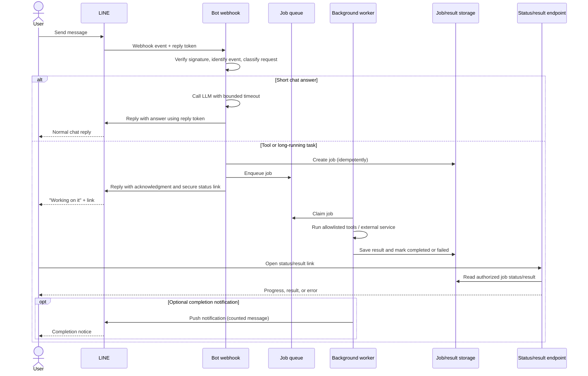

# This procedure of LINE App long running Bot refere from a existing source by hand-code
## And a coding agent read and write this documents, well done. 

# LINE Bot Reply and Long-Running Job Flow

**Status:** Proposed  
**Version:** 1.0  
**Date:** 2026-11-14  
**Scope:** LINE webhook handling, LLM responses, tool execution, and generated files

## Overview

The bot should respond to ordinary chat messages with a normal LINE reply when the LLM can produce a short answer within a bounded time. When a request needs a tool, a slow external service, or large file generation, the bot should acknowledge the request immediately and return a secure job-status/result link. A background worker performs the work; the user can open the link to check progress and retrieve the result.

This design aims to avoid unnecessary **counted LINE messages**, especially completion notifications sent with the push-message API. It does not avoid all LINE messaging: the initial acknowledgment is still a reply message using the webhook event's reply token. LINE reply tokens themselves are not a billable token unit.

## LINE quota and reply-token distinction

LINE's current Messaging API pricing documentation lists reply messages as **not counted** toward the message count for the subscription plan. Push, multicast, broadcast, and narrowcast messages are counted. The number of recipients, rather than the number of message objects in a request, determines the message count.

Therefore:

- Reply to the user's webhook event for a quick answer or a task acknowledgment.
- Do not send a completion push by default; link users to a status/result page instead.
- Send a push completion notification only when the user explicitly opts in or the product requires it.
- Treat the reply token as a short-lived, single-use credential for replying to that event, not as a reusable or billable message token. Use it promptly and do not store it for background work.

Check LINE's current documentation and the account's regional plan before making billing decisions; plan limits and pricing can vary by region.

## Proposed flow

The webhook HTTP response (`200 OK`) and a LINE reply message are separate things. Return the webhook HTTP response promptly after signature verification, event deduplication, and either replying or enqueuing the job. Do not keep the webhook request open while a long task runs.

## Request classification

Classify a request before executing expensive work:

1. Handle simple commands and ordinary chat in the normal reply path.
2. Decide whether an LLM tool call is available using an explicit, allowlisted tool registry.
3. Give each tool an expected execution class or timeout. If a selected tool may exceed the synchronous budget, submit it as a job instead of running it inside the webhook request.
4. Validate tool arguments and enforce authorization, resource limits, and allowed external destinations before enqueueing.
5. If an LLM or external call unexpectedly exceeds the short-answer budget, stop waiting and use the job flow when the request can safely be resumed. Do not rely on an LLM's unvalidated claim that a task is "long-running."

The synchronous time budget should be configured and tested against the webhook platform's delivery expectations. It should leave enough time to send the LINE reply before the reply token expires.

## Job and result behavior

The acknowledgment should contain a concise description, a status link, and an explanation that the page can be refreshed to see the result. The link should lead to a bot-owned status endpoint, not directly to a permanent file under a public static directory.

Suggested job states:

| State | Meaning |
|---|---|
| `queued` | Accepted and waiting for a worker |
| `running` | A worker is processing the request |
| `completed` | Result is ready |
| `failed` | Work failed; expose a safe, useful message |
| `expired` | Job or result retention period ended |

Store enough information to resume and audit work, for example:

- An opaque job ID and webhook event ID
- Requester identity and conversation context needed for access control
- A validated task type and arguments
- State, timestamps, and a safe progress summary
- Result metadata and a private storage reference
- A safe failure code/message and an expiry time

Use persistent queue and job storage in production. In-memory dictionaries or module-level pending-job flags are not durable, do not coordinate across worker processes, and can associate one user's work with another user's request.

## Link security and privacy

- Use an unguessable job identifier or an expiring signed link.
- Verify that the requester is allowed to see the job and its result.
- Do not expose LINE user IDs, reply tokens, access tokens, raw prompts, or provider credentials in URLs or logs.
- Keep generated files outside publicly served static directories. Stream them through an authorization-checked endpoint or issue short-lived signed downloads.
- Set file-size and content-type limits, and define cleanup/retention behavior for inputs, outputs, and failed jobs.
- Treat external-service results and uploaded files as user data; avoid logging their full contents.

## Failure handling and retries

- Deduplicate webhook deliveries using the LINE webhook event ID where available; enqueue at most one job per event.
- Make job execution idempotent where possible. Record attempts and avoid duplicating expensive side effects on retries.
- Reply with a clear error if the job cannot be accepted or enqueued.
- If a worker fails after acknowledgment, mark the job failed and show a safe explanation on its status page.
- If a result is too large for LINE, keep it in protected storage and return it through the status/result link.
- Do not attempt to save an expired reply token for later completion. A later LINE notification requires a push message and is subject to LINE's message-count rules.

## Existing project evidence

The repository already contains an early version of the wait-and-link idea:

- [app_whisper.py](../../app_whisper.py) sends a wait message and a future SRT URL for a YouTube transcription.
- [app_whisper-OKCopy2.py](../../app_whisper-OKCopy2.py) contains a similar pending-transcription pattern.
- In those versions, the long operation is still called from the webhook request path, and job state is stored in module-level variables. These are prototypes, not a durable background-job implementation.
- [start.sh](../../start.sh) currently launches `index_ollama.py`, so the YouTube wait-and-link flow is not necessarily the active entrypoint.

## Rollout plan

1. Pick one supported LINE bot entrypoint and SDK version.
2. Add a request classifier and bounded synchronous LLM path.
3. Add persistent job records, queueing, and a worker for selected long-running tools.
4. Add a private status/result endpoint with authorization, expiry, and file cleanup.
5. Keep completion push notifications disabled by default; measure any opt-in push usage against the LINE account quota.
6. Test signature validation, duplicate webhook delivery, short-answer timeout, queue failure, worker retry, cross-user access denial, expired links, and result cleanup.

## References

- [LINE Messaging API: Sending messages](https://developers.line.biz/en/docs/messaging-api/sending-messages/#reply-messages)
- [LINE Messaging API: Pricing and message counts](https://developers.line.biz/en/docs/messaging-api/pricing/)
- [LINE Messaging API: Display a loading animation](https://developers.line.biz/en/docs/messaging-api/use-loading-indicator/)
