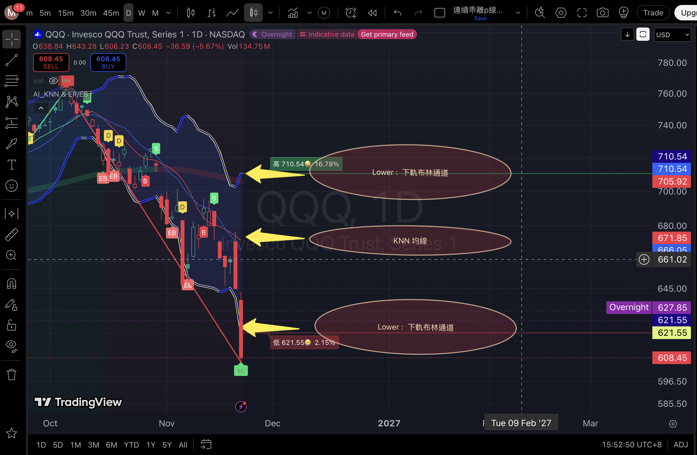

# 葛蘭碧八大法則 AI\_KNN 指標:內部演算法解析

Nov 23, 2026 · @Monoad0620

## 前言與設計哲學

這個指標用「成本結構」來讀價格:價格離平均成本越遠,回歸的力量越大;回到平均成本附近時,則看它能不能站穩。整套訊號為兩種交易者設計,並依時間先後出現:`EB`/`ES` → `D`/`R` → `B`/`S`。

- **左側交易者 (Left-side Trader)**:趨勢尚未轉向,先在極端乖離處用小倉位試單。
- **右側交易者 (Right-side Trader)**:等價格突破平均成本才進場,用價格換取確定性。

| 訊號 | 英文原名 | 角色 | 出現時機 |
| --- | --- | --- | --- |
| `EB` | Early Buy | 左側試單買進 | 負乖離後價格回到下軌內 |
| `ES` | Early Sell | 左側試單賣出 | 正乖離後價格回到上軌內 |
| `D` | Dump | `EB` 試單失敗的離場訊號 | `EB` 後曾站上,之後收盤跌回 `EB` 收盤價下方 |
| `R` | Re-buy | `ES` 方向失敗的回補訊號 | `ES` 後曾走低,之後收盤回升到 `ES` 收盤價上方 |
| `B` | Buy | 右側買點 | 收盤價向上突破 KNN 均線 |
| `S` | Sell | 右側賣點 | 收盤價向下跌破 KNN 均線 |

本文以 Pine Script v6 程式碼為準:通道取收盤價 (`close`) 14 期、2.0 倍標準差 (Standard Deviation)。

## 三條線的意義:乖離與平均成本

上軌是正乖離的邊界,下軌是負乖離的邊界,中間那條是 KNN 均線,代表平均成本。三條線把價格切成三個區域,後面所有訊號都在區域交界處發生。

| 線 | 英文 | 概念 | 價格在此線外代表什麼 |
| --- | --- | --- | --- |
| 上軌 | Upper Band | 正乖離 (Positive Deviation) | 價格高於平均成本過多,追高者獲利豐厚,獲利回吐壓力增加 |
| 下軌 | Lower Band | 負乖離 (Negative Deviation) | 價格低於平均成本過多,持有者普遍套牢,賣壓趨於衰竭 |
| 中線 | KNN Moving Average (`knnMA_`) | 平均成本 (Average Cost) | 多空雙方的成本重心,站上偏多、跌破偏空 |

> **【圖 1】** QQQ 日線全景:標出上軌 (Upper)、下軌 (Lower)、KNN 均線與粗帶長期線 `MAknn_`,讓讀者先認識三條線。

### 上下軌:布林通道 (Bollinger Bands)

上下軌由 14 期收盤價的簡單移動平均 (SMA) 加減 2.0 倍標準差得出。通道線的顏色會隨方向改變:軌道上升為藍色,持平為淺灰,下降為黃綠色,讓你一眼看出通道是在擴張還是收窄。

布林通道自己的中軌 `Basis`(14 期 SMA)仍然畫在圖上,但只當參考。**這套指標沒有把它當作平均成本**,下文所有「中線」都指 KNN 均線。

### 中線:為什麼選 KNN 均線而不是布林中軌

簡單移動平均把期間內每一根 K 棒等權重平均,一根極端的棒子就能把均線拉偏,那個價位卻不一定有人真的在那裡成交。KNN 均線反過來問:「最近這幾十根里,哪些價位最貼近目前的價格?」然後只拿這些價位來平均,所以它更貼近市場「反覆成交過的價位」,也就是平均成本的概念。

計算鏈如下(預設參數):

1. `value_in`:預設取 `hl2`(高低價中點)的 5 期 SMA,作為候選價位。
2. `target_in`:預設取收盤價的 5 期 RMA (`Price Action`),作為目前目標。
3. `meanOfKClosest()`:在過去 30 根 (`windowSize`) 的候選價位中,找出距離目標最近的 3 個 (`numberOfClosestValues`),取平均,得到 `knnMA`。
4. `knnMA_ = ta.wma(knnMA, 5)`:再做 5 期加權移動平均 (WMA) 平滑,這才是圖上的 KNN 均線。

線的顏色會隨斜率變化:上升為萃姆綠 (lime),下降為紅,持平為橙色。

### 長期平均線

`MAknn_ = ta.rma(knnMA, 50)` 是更慢的長期平均成本,以粗淺色帶畫在 KNN 均線後方(上升淺綠、下降淺紅)。它不產生買賣點,僅提供趨勢背景,並用於「KNN 均線穿越長期均線」的警報。

## EB、ES:左側交易者的試單

`EB` 和 `ES` 出現在價格剛從極端乖離回到通道內的那一根,是左側交易者用小倉位試探「乖離回歸」是否成立的試單 (Probe Trade)。它不保證轉折,只代表極端乖離已經開始收斂。

### 觸發條件

每個訊號有兩條路徑,任一成立即觸發:

| 路徑 | `EB` Early Buy(負乖離後) | `ES` Early Sell(正乖離後) |
| --- | --- | --- |
| ① 收盤回軌 | 前一根收盤在下軌下方 (`close[1] < lower[1]`),本根收盤回到下軌之上 | 前一根收盤在上軌上方 (`close[1] > upper[1]`),本根收盤回到上軌之下 |
| ② 針刺收回 (Wick Pierce) | 本根最低價刺破下軌 (`low < lower`),前一根最低價仍在下軌上方,且本根收盤站回下軌之上 | 本根最高價刺破上軌 (`high > upper`),前一根最高價仍在上軌下方,且本根收盤落回上軌之下 |

路徑 ① 抓到「收盤已經跑到軌外、隨後拉回」的情況;路徑 ② 抓到「只用影線刺穿、當根就被收回」的情況,代表極端價位的賣壓(或買盤)在同一根 K 棒內已被吸收。

圖上 `EB` 標籤畫在 K 棒下方(淺紅),`ES` 標籤畫在上方(藍色)。

> **【圖 2|待補】** QQQ 日線:路徑 ① 的 `EB`(收盤先跌出下軌,再收回軌內)。若能再找一例 `ES` 更好。

> **【圖 3|待補】** QQQ 日線:路徑 ② 的針刺收回 `EB`(影線刺穿下軌,當根收回軌內)。

### 對應葛蘭碧八大法則

程式在最後一根 K 棒上會把 `EB` 標成 `B4`(乖離反抽買點,低價抓底、左側買入),把 `ES` 標成 `S8`(急漲後反轉下跌)。兩者都是葛蘭碧法則中「價格遠離均線後的回歸」。

### 試單的倉位概念

左側交易的特點是進場早、價格好,代價是還沒有確認轉向。所以 `EB`/`ES` 應視為小倉位試單,並且一開始就定好失效點:失效由下一章的 `D`/`R` 訊號定義。不定失效點的 `EB`/`ES` 不是試單,只是猜測。

## D、R:脫離風險的必要操作

`D` 和 `R` 是左側試單的失效出口:`EB` 之後收盤跌回 `EB` 當根收盤價之下,就發出 `D` (Dump);`ES` 之後收盤升回 `ES` 當根收盤價之上,就發出 `R` (Re-buy)。左側試單的風險是「回歸沒有發生」,`D`/`R` 把這個失敗定義成一個可以檢驗的價位,而不是靠感覺判斷。

### 運作方式:觀察狀態機 (State Machine)

&#91;embedded content: D/R 觀察狀態機 · 兩條獨立流程\]

兩個方向各有一條獨立的觀察線。`EB` 啟動後,只有 `D` 或 `B` 能結束它;`ES` 啟動後,只有 `R` 或 `S` 能結束它。

### 規則細節

- **參考價 (Reference Price)**:`EB`/`ES` 出現當根的收盤價。新的 `EB`/`ES` 出現時,參考價會被刷新。
- **穿越 (Crossing)**:必須是前一根收盤仍在參考價的一側 (`close[1] >= 參考價`,`R` 則為 `<=`),本根收盤才穿到另一側。不是每根低於參考價的 K 棒都發出訊號。
- **一次性**:`D`/`R` 發出後觀察結束,要等下一個 `EB`/`ES` 才會重新啟動。
- **取消 (Cancel)**:`B` 出現代表價格已突破平均成本,這筆左側試單的風險性質改變,不再用 `D` 追蹤;`S` 出現同理取消 `R`。
- **同一根 K 棒的順序**:先檢查 `D`/`R` 是否觸發,再檢查是否取消。若 `EB` 和 `B` 在同一根出現,觀察一開始就被取消。
- **圖面**:`D` 以黃底黑字標在 K 棒上方,`R` 標在下方。

## B、S:平均成本的突破點

`B` (Buy) 和 `S` (Sell) 出現在收盤價穿越 KNN 均線的那一根,也就是價格突破平均成本的時刻。它是右側交易者 (Right-side Trader) 在趨勢確認後的進場點,設計上也是他們較合理的最後機會。

### 觸發條件

| 訊號 | 條件 | 程式判斷 |
| --- | --- | --- |
| `B` | 收盤價由下往上突破 KNN 均線 | `close[1] < knnMA_[1]` 且 `close > knnMA_` |
| `S` | 收盤價由上往下跌破 KNN 均線 | `close[1] > knnMA_[1]` 且 `close < knnMA_` |

`B` 標在 K 棒下方,`S` 標在上方。預設顏色為 `B` 紅、`S` 綠(符合台灣紅漲綠跌的習慣),可在設定的 `KNN Color` 群組調整。

> **【圖 4|待補】** QQQ 日線:`B` 與 `S` 各一例,標出收盤價穿越 KNN 均線的那一根。

### 為什麼是右側的最後機會

平均成本是多空雙方的分界。價格站上成本線,代表越來越多持有者回到不虧;跌破則相反。右側交易者不猜轉折,等這條線被穿越才行動,代價是進場價格較差、不再貼近通道外緣。`B` 之後,價格往上就進入正乖離區,追價的安全邊際逐步縮小,所以錯過 `B` 後再追的合理性最低。

### 左側與右側的對照

| 項目 | 左側 `EB`/`ES` | 右側 `B`/`S` |
| --- | --- | --- |
| 進場依據 | 極端乖離後的回歸跡象 | 收盤價穿越平均成本 |
| 進場位置 | 靠近通道外緣,價格較好 | 靠近中線,價格較差 |
| 確定性 | 較低,需要 `D`/`R` 保護 | 較高 |
| 失效定義 | `D`/`R` | 反向的 `S`/`B` |

### 對 `EB`/`ES` 試單的影響

`B` 出現時,已持有 `EB` 試單的交易者得到驗證:價格不僅回歸,還突破了成本線,`D` 的觀察同時被取消。`S` 對 `ES` 與 `R` 同理。對多方持倉者,`S` 也是價格重新失守平均成本的警示。

### 對應葛蘭碧八大法則

程式在最後一根 K 棒上把 `B` 標成 `B1`(突破,右側買入),把 `S` 標成 `S5`(均線跌破賣出)。

## 完整情境走讀

三種情境涵蓋了訊號最常見的組合順序。每個情境請在 QQQ 日線上挑一個符合的例子截圖,並在圖中標出訊號順序。

### 情境 A:理想劇本——左側試單被右側確認

順序:`EB` → 價格站穩參考價 → `B`。

1. 價格先跌出下軌,再收回軌內,`EB` 出現,左側交易者用小倉位試單。
2. 往後的收盤都站在 `EB` 當根收盤價之上,`D` 不觸發。
3. 價格突破 KNN 均線,`B` 出現。`D` 的觀察同時取消,右側交易者在這裡進場。

> **【圖 5|待補】** QQQ 日線:一次 `EB` → `B` 的完整上行。標出 `EB`、參考價、`B` 三個位置。

### 情境 B:左側試單失敗——觸發 `D`

順序:`EB` → 站上參考價 → 收盤跌回參考價之下 → `D`。

1. `EB` 出現,試單進場。
2. 價格短暫反彈,但在突破 KNN 均線之前就轉弱。
3. 收盤由上往下穿越參考價,`D` 出現,試單認賠離場,損失被限制在試單尺寸內。

> **【圖 6|待補】** QQQ 日線:一次 `EB` → `D`。標出參考價線與 `D` 的位置,並注意反彈有沒有碰到 KNN 均線。

### 情境 C:對稱的賣出側

賣出側完全對稱:`ES` → `R`(空方失敗,收盤回升到參考價之上),或 `ES` → `S`(跌破平均成本,取消 `R` 的觀察,左右側在這裡會合)。

> **【圖 7|待補】** QQQ 日線:一次 `ES` → `S` 或 `ES` → `R`。若能兩種結果各找一例更好。

### 一張表看三種情境

| 情境 | 訊號順序 | 結果 | 左側交易者 | 右側交易者 |
| --- | --- | --- | --- | --- |
| A | `EB` → `B` | 回歸成立且突破成本線 | 試單被驗證,取消 `D` 觀察 | `B` 是進場點 |
| B | `EB` → `D` | 回歸沒有成立 | `D` 離場 | 沒有進場訊號,不受影響 |
| C | `ES` → `R` 或 `S` | 賣出側對稱 | `R` 回補或由 `S` 確認 | `S` 是賣出點 |

## 限制與失效情境

這套訊號是用價格的相對位置推論的,下列六種情況會讓它失準,使用前要知道。

### 強趨勢中的帶狀行走 (Band Walk)

價格沿著上軌(下軌)連續走勢時,收盤多半留在軌外,`ES`(`EB`)不會觸發。一旦某根收盤短暫回到軌內,就會出現一個趨勢中途的 `ES`。強多頭裡這種 `ES` 比較像降溫訊號,未必是反轉;之後價格繼續上行、收在參考價之上就會發出 `R`,這正是 `R` 要承擔的風險。

### 盤整期的反覆穿越 (Whipsaw)

價格在 KNN 均線附近來回時,`B`/`S` 會密集交替。KNN 均線經過 WMA 平滑,橫盤時走平,收盤很容易反覆穿越它。在中線附近連續出現的 `B`/`S` 可信度較低;較可靠的情況是它們出現在 `EB`/`ES` 之後,或與長期均線 `MAknn_` 的方向一致。

### 即時 K 棒與重繪 (Repaint)

`EB`/`ES`/`B`/`S`/`D`/`R` 的條件都用當根收盤價,且沒有 `barstate.isconfirmed` 保護。歷史 K 棒的結果是固定的,但即時 K 棒在收盤前,條件可能時而成立、時而不成立,標籤會出現又消失。日線請等收盤後再依訊號行動。次級時間框架目標 (Secondary Targets) 雖然使用 `request.security(..., lookahead_on)`,但取 `[1]` 偏移、預設關閉,與這六個訊號無關。

### 針刺路徑只抓第一次

`EB`/`ES` 的路徑 ② 要求前一根的最低(最高)價仍在軌內,所以只在第一次刺穿時成立。連續多根 K 棒都刺在軌外,後續的訊號要靠路徑 ①(收盤回軌)。

### 暖機期與資料長度

KNN 均線需要 30 根的候選價位視窗,長期線 `MAknn_` 使用 50 期 RMA,通道 14 期。圖表最左側的前幾十根訊號不可靠,日線建議至少載入兩年以上資料。

### KNN 預測不參與訊號

程式中的 `knn_prediction`(趨勢預測)只用來畫背景色,需開啟 `Trend Prediction Color` 才會顯示,不參與 `EB`/`ES`/`D`/`R`/`B`/`S` 的判斷。

## 參數調整指南

先用預設值,一次只改一個參數,並在同一段 QQQ 日線上比較 `EB`/`ES` 與 `B`/`S` 的出現次數和位置。下表的「調大」「調小」是方向性的說明,實際幅度需要用資料驗證。

| 參數 | 預設 | 控制什麼 | 調大 | 調小 |
| --- | --- | --- | --- | --- |
| `maLen` (與 `PriceValue`) | `hl2` / 5 | 候選價位 `value_in` 的種類與平滑期 | 候選價位更平滑,均線較慢 | 較靈敏,雜訊較多 |
| `maLen_` (與 `TargetValue`) | `Price Action` / 5 | 目標值 `target_in` 的種類與平滑期 | 目標較慢,挑選的價位較穩定 | 目標貼近現價,均線較快轉向 |
| `numberOfClosestValues` (K) | 3 | 參與平均的最近鄰價位數 | 平均的價位越多,均線越平滑、反應越慢 | 更貼近目前價格,更靈敏 |
| `smoothingPeriod` | 50 | 長期均線 `MAknn_` 的 RMA 期數 | 長期線更慢更穩 | 長期線跟得更緊 |
| `lengthBB`、`multBB` | 14 / 2.0 | 通道的長度與標準差倍數(目前寫死在程式裡,需改程式碼) | 通道更寬、更慢,`EB`/`ES` 較少 | 通道較窄,`EB`/`ES` 較多 |

`windowSize` 由程式自動決定(`max(K, 30)`),不是輸入參數;只有 K 超過 30 時它才會變大。

### 調整的思路

- 想減少盤整期的 `B`/`S` 雜訊:先調大 K 或 `maLen`,讓均線更平滑。
- 想讓 `EB`/`ES` 更早出現:調小 `multBB`,但假訊號會跟著增加,`D`/`R` 也會更常發出。
- 這些調整都是靈敏度與穩定性的交換,沒有哪一組「最佳」值;建議以你的交易週期為準。

## 輔助模組

主訊號之外,程式還包含四個輔助模組。它們都不改變 `EB`/`ES`/`D`/`R`/`B`/`S` 的判斷,只提供交叉驗證。

| 模組 | 預設狀態 | 作用 | 和主訊號的關係 |
| --- | --- | --- | --- |
| 多時間框架 RSI (MTF RSI) 與 Superstack | 表格關閉 | 同時看 5m/15m/30m/1h/4h/12h/D/W 的 RSI(14);至少 3 個時間框架同時超賣(RSI ≤ 35,極端 30)時畫 Superstack 標籤 | 用來驗證 `EB` 的超賣程度;類似的超買判斷對 `ES` |
| 之字形轉折 (ZigZag) | 開啟 | 用 Depth 12、Deviation 5、Backstep 2 畫轉折線,並標記 `HH`/`LH`/`HL`/`LL` 結構 | 判斷 `EB` 發生在結構低點附近 (`HL`),還是繼續創低的下跌中 (`LL`) |
| ER/ES 線 | 開啟 | 把 `EB`/`ES` 當時的通道價位畫成延伸虛線,並提供警報 | 與 `D`/`R` 是兩種不同的失效定義,見下文 |
| 極短線高低標 (KNN Regression Targets) | 關閉 | 用 KNN 回歸估計當日開盤到最高、最低的距離,畫出賣區與買區 | 獨立的每日目標參考,和訊號無關 |

### ER/ES 線與 `D`/`R` 的差別

`D`/`R` 的參考價是「訊號當根的收盤價」;ER/ES 線的參考價是「訊號當時的通道上(下)軌價位」。

- `ES` 出現時記下當時的上軌價位,畫成綠色虛線。價格其後若收盤再度站上這個價位(且 `S` 尚未出現),虛線會延續並觸發 `ES_over_price`。
- `EB` 出現時記下當時的下軌價位,畫成紅色虛線。價格其後若收盤再度跌破這個價位(且 `B` 尚未出現),虛線會延續並觸發 `EB_over_price`。
- 所以 ER/ES 線是判斷「價格是否重新到了極端乖離的價位」,`D`/`R` 則是判斷「試單成本是否被收盤價否定」。前者偏向警報,後者是明確的離場標記。

### 其他顯示

圖上還有一組最後一根 K 棒才會畫的標籤:「預測上下通道價格」與葛蘭碧八大法則文字,顯示目前距上下軌的百分比與對應的訊號名稱。

## 警報 (Alert) 設定清單

`B`/`S` 有幾乎對應的警報;`EB`/`ES` 只透過「葛蘭碧八買賣點」和 ER/ES 線警報間接提醒;`D`/`R` 目前沒有專屬警報。

| 警報名稱 | 觸發條件 | 對應訊號 |
| --- | --- | --- |
| `Knn Crossunder Close` | `knnMA_` 由上往下穿越收盤價 | 幾乎等同 `B`(收盤站上 KNN 均線) |
| `Knn Crossover Close` | `knnMA_` 由下往上穿越收盤價 | 幾乎等同 `S` |
| `Knn Crossover Average Knn` / `Knn Crossunder Average Knn` | `knnMA_` 穿越長期線 `MAknn_` | 短期與長期成本線交叉 |
| `Knn Switch Up` / `Knn Switch Dn` | `knnMA_` 由跌轉漲、由漲轉跌 | 均線方向改變 |
| `Knn is Neutral` | `knnMA_` 轉為持平色 | 均線方向不明 |
| `Positive Prediction` / `Negative Prediction` | `knn_prediction` 背景變化 | 趨勢預測(不參與主訊號) |
| 葛蘭碧八買賣點 | `GAlert`:最後一根出現 `EB`(`B4`)、`ES`(`S8`)、`B`(`B1`)、`S`(`S5`) | 四種主訊號的綜合提醒 |
| `EarlyBuy xcrossover` / `EalrySell xcrossover` | `EB_over_price` / `ES_over_price`(名稱拼寫沿用原程式) | ER/ES 線被價格重新到達 |
| `Combinational_condition` | ER/ES 線警報同時滿足 30 分鐘 Superstack | 組合條件 |
| ZigZag 系列 | `New Higher High`、`Direction Changed` 等 7 個 | 結構變化 |
| Superstack 系列 | 各時間框架超賣(超買) | RSI 堆疊極端 |

程式中的 `alert()` 呼叫有三個:ZigZag 方向變化、`Alert Now`(預設開啟,訊號出現且 Superstack 成立時發出)、以及 `alert8Gstate`(預設關閉,發出葛蘭碧訊號名稱)。

### 待確認事項

以下是我閱讀程式碼後的觀察,沒有在 TradingView 上實測,引用前請先驗證:

1. **超買側 Superstack 警報可能不會觸發**:`superstackOb30`、`superstackOb1h`、`superstackOb4h`、`superstackOb12h`、`superstackOb1D`、`superstackOB` 用的是 `osCount` 和 `osType == 'overbought'`。但 `getStacks()` 回傳的 `osType` 只會是 `'oversold'` 或 `'extreme oversold'`,這些條件似乎永遠不成立;應改用 `obCount`/`obType`。這也影響 `ES` 側的 `Combinational_condition`。
2. **Superstack 變數可能被遮蔽 (Shadowing)**:這些變數在 `if showRSITables or GAlert` 區塊內用 `=` 重新宣告(而不是 `:=`),外層同名變數可能仍然是 `false`,造成警報沒有反應。
3. **`GAlert` 只在最後一根成立**:它在 `barstate.islast` 區塊內設定,歷史 K 棒上不會為 `true`,所以「葛蘭碧八買賣點」警報只適合即時監控。
4. **`D`/`R` 缺少警報**:建議新增兩行 `alertcondition(dumpSignal, ...)` 與 `alertcondition(rebuySignal, ...)`。這是低風險的改動,需要的話我可以直接加到 Pine 檔。

## 風控、倉位與回測驗證

以下是這套指標的使用框架與驗證方向,不構成投資建議。每個訊號都是機率性的,不是保證。

### 四層風險結構

| 層級 | 訊號 | 風險含義 |
| --- | --- | --- |
| 1. 試單 | `EB`/`ES` | 極端乖離回歸的跡象,風險是回歸沒有發生 |
| 2. 試單失效 | `D`/`R` | 試單的成本被收盤價否定 |
| 3. 趨勢確認 | `B`/`S` | 平均成本被突破,右側進場 |
| 4. 確認失效 | 反向的 `S`/`B` | 成本線重新失守 |

### 倉位原則

- **先定失效點再進場**:`EB`/`ES` 就是試單,它的失效條件是 `D`/`R`。沒有定義失效點的進場,不屬於這套框架。
- **左側小、右側確認後再加碼**:左側用小倉位換取好價格,右側 `B`/`S` 出現才是確定性較高的進場點。兩者的倉位比例由你自己決定。
- **不要用 `EB`/`ES` 對抗強趨勢**:帶狀行走 (Band Walk) 時試單容易連續被 `D`/`R` 停損。

### 回測驗證:建議用事件研究 (Event Study)

先用 QQQ 日線,記錄每一次 `EB`/`ES` 之後發生的事,再分組統計:

| 問題 | 統計量 |
| --- | --- |
| `EB` 之後結局是 `B` 還是 `D`? | `EB`→`B`、`EB`→`D`、被新 `EB` 刷新三類的次數與比例 |
| `D` 代價有多大? | `D` 當根收盤價相對 `EB` 收盤價的報酬,以及期間最大不利波動 |
| `B` 之後走多遠? | `B` 後 5/10/20 日報酬分布 |
| 左側還是右側更划算? | 用 `EB` 進場與用 `B` 進場的平均成本差與最終報酬 |
| 盤整與趨勢中的 `B`/`S` 哪個可靠? | 依 `MAknn_` 方向分組比較勝率 |

驗證時要避開未來函數:訊號在收盤確認,應用下一根開盤價進場。樣本數要夠,並用 QQQ 以外的標的交叉驗證。

目前你的 Python 引擎涵蓋 BB %B 與 Two-Pole 振盪器,還沒有移植這支 KNN 指標。若要程式化回測,需要先把 KNN 均線與 `EB`/`ES`/`D`/`R`/`B`/`S` 的狀態機移植成 Python。

## 版本紀錄 (Changelog)

原程式為《葛蘭碧八大法則 V1.0 AI\_KNN ALERT w ER/ES line VERSION》,作者 momosan2692\_friends,授權為 Mozilla Public License 2.0。標題保留不變。

Source code here 

Pine Script 原始碼（點擊展開）


// This Pine Script™ code is subject to the terms of the Mozilla Public License 2.0 at https://mozilla.org/MPL/2.0/
// © momosan2692_friends
// hint blog url: https://momosan2692.github.io/2026/11/23/AI-KNN.html
//@version=6
 
indicator('葛蘭碧八大法則 V1.0 AI_KNN ALERT w ER/ES line VERSION', 'AI_KNN & ER/ES', overlay = true, max_bars_back = 4000)
//
// Parts start here

// ~~ Inputs {
PriceValue = input.string('hl2', options = ['hl2', 'VWAP', 'sma', 'wma', 'ema', 'hma'], group = '', inline = 'Value')
maLen = input.int(5, minval = 2, maxval = 200, title = '', group = '', inline = 'Value')
TargetValue = input.string('Price Action', options = ['Price Action', 'VWAP', 'Volatility', 'sma', 'wma', 'ema', 'hma'], group = '', inline = 'Target')
maLen_ = input.int(5, minval = 2, maxval = 200, title = '', group = '', inline = 'Target')
// Input parameters for the KNN Moving Average
numberOfClosestValues = input.int(3, 'Number of Closest Values', 2, 200)
smoothingPeriod = input.int(50, 'Smoothing Period', 2, 500)
windowSize = math.max(numberOfClosestValues, 30)

// knn Color
Upknn_col = input.color(color.lime, title = '', group = 'KNN Color', inline = 'knn col')
Dnknn_col = input.color(color.red, title = '', group = 'KNN Color', inline = 'knn col')
Neuknn_col = input.color(color.orange, title = '', group = 'KNN Color', inline = 'knn col')
// MA knn Color
Maknn_col = input.color(color.teal, title = '', group = 'MA KNN Color', inline = 'MA knn col')
// BG Color
bgcolor = input.bool(false, title = 'Trend Prediction Color', group = 'BG Color', inline = 'bg')
Up_col = input.color(#092fe9, title = '', group = 'BG Color', inline = 'bg')
Dn_col = input.color(color.red, title = '', group = 'BG Color', inline = 'bg')
Up_Early_col = input.color(#092fe9, title = '', group = 'BG Color', inline = 'bg')
Dn_Early_col = input.color(#f66b6b, title = '', group = 'BG Color', inline = 'bg')
//~~~~~~~~~~~~~~~~~~~~~~~~~~~~~~~~~~~~~~~~~~~~~~~~~~~~~~~~~~~~~~~~~~~~~~~~~~~~~~~~~~~~~~~~~~~~~~~~~~~~~~~~~~~~~~~~~~~~~}

// ~~ kNN Classifier {
value_in = switch PriceValue
    'hl2' => ta.sma(hl2, maLen)
    'VWAP' => ta.vwap(close[maLen])
    'sma' => ta.sma(close, maLen)
    'wma' => ta.wma(close, maLen)
    'ema' => ta.ema(close, maLen)
    'hma' => ta.hma(close, maLen)

meanOfKClosest(value_, target_) =>
    closestDistances = array.new_float(numberOfClosestValues, 1e10)
    closestValues = array.new_float(numberOfClosestValues, 0.0)
    for i = 1 to windowSize by 1
        value = value_[i]
        distance = math.abs(target_ - value)
        maxDistIndex = 0
        maxDistValue = closestDistances.get(0)
        for j = 1 to numberOfClosestValues - 1 by 1
            if closestDistances.get(j) > maxDistValue
                maxDistIndex := j
                maxDistValue := closestDistances.get(j)
                maxDistValue
        if distance < maxDistValue
            closestDistances.set(maxDistIndex, distance)
            closestValues.set(maxDistIndex, value)
    closestValues.sum() / numberOfClosestValues

// Choose the target input based on user selection
target_in = switch TargetValue
    'Price Action' => ta.rma(close, maLen_)
    'VWAP' => ta.vwap(close[maLen_])
    'Volatility' => ta.atr(14)
    'sma' => ta.sma(close, maLen_)
    'wma' => ta.wma(close, maLen_)
    'ema' => ta.ema(close, maLen_)
    'hma' => ta.hma(close, maLen_)

knnMA = meanOfKClosest(value_in, target_in)
//~~~~~~~~~~~~~~~~~~~~~~~~~~~~~~~~~~~~~~~~~~~~~~~~~~~~~~~~~~~~~~~~~~~~~~~~~~~~~~~~~~~~~~~~~~~~~~~~~~~~~~~~~~~~~~~~~~~~~}

// ~~ kNN Prediction {
// Function to calculate KNN Classifier
price = math.avg(knnMA, close)
c = ta.rma(knnMA[1], smoothingPeriod)
o = ta.rma(knnMA, smoothingPeriod)

// Defines KNN function to perform classification
knn(price) =>
    Pos_count = 0
    Neg_count = 0
    min_distance = 10e10
    nearest_index = 0
    for j = 1 to 10 by 1
        distance = math.sqrt(math.pow(price[j] - price, 2))
        if distance < min_distance
            min_distance := distance
            nearest_index := j
            Neg = c[nearest_index] > o[nearest_index]
            Pos = c[nearest_index] < o[nearest_index]
            if Pos
                Pos_count := Pos_count + 1
                Pos_count
            if Neg
                Neg_count := Neg_count + 1
                Neg_count
    output = Pos_count > Neg_count ? 1 : -1
    output

// Calls KNN function and smooths the prediction
knn_prediction_raw = knn(price)
knn_prediction = ta.wma(knn_prediction_raw, 3)
//~~~~~~~~~~~~~~~~~~~~~~~~~~~~~~~~~~~~~~~~~~~~~~~~~~~~~~~~~~~~~~~~~~~~~~~~~~~~~~~~~~~~~~~~~~~~~~~~~~~~~~~~~~~~~~~~~~~~~}

// ~~ Plots {
// Plots for display on the chart
knnMA_ = ta.wma(knnMA, 5)
knnMA_col = knnMA_ > knnMA_[1] ? Upknn_col : knnMA_ < knnMA_[1] ? Dnknn_col : Neuknn_col
Classifier_Line = plot(knnMA_, 'Knn Classifier Line', knnMA_col)

knnTrend = knnMA_ > knnMA_[1] ? 'U' : knnMA_ < knnMA_[1] ? 'D' : 'E'
//knnMA_txt         = knnTrend == knnTrend[1]? "": (knnTrend=="U" and knnTrend[1]=="D")? "B": "S"  

knnMA_shape_sell = close[1] > knnMA_[1] and close < knnMA_ ? 1 : na
knnMA_shape_buy = close[1] < knnMA_[1] and close > knnMA_ ? 1 : na

plotshape(knnMA_shape_buy, title = 'Buy', text = 'B', location = location.belowbar, style = shape.labelup, size = size.tiny, color = Dnknn_col, textcolor = color.white)
plotshape(knnMA_shape_sell, title = 'Sell', text = 'S', location = location.abovebar, style = shape.labeldown, size = size.tiny, color = Upknn_col, textcolor = color.white)

// LongTerm True Average line display 
ltATRflag = input.bool(true, title = 'Longterm True Average Line', group = 'LongATR', inline = 'LATR')

MAknn_ = ltATRflag ? ta.rma(knnMA, smoothingPeriod): na

Maknn_col0 = (MAknn_ > MAknn_[1]) and ltATRflag ? color.lime : color.red
Maknn_col1 = (MAknn_ > MAknn_[1]) and ltATRflag ? color.new(color.lime, 85) : color.new(color.red, 85)

plot(MAknn_, 'Average Knn Classifier Line',linewidth=10, color=Maknn_col1) // out of line 
//plot(MAknn_, 'Average Knn Classifier Line',linewidth=1, color=Maknn_col0) // line of core 

green = knn_prediction < 0.5
red = knn_prediction > -0.5
bgcolor(green and bgcolor ? color.new(Dn_col, 80) : red and bgcolor ? color.new(Up_col, 80) : na)
//~~~~~~~~~~~~~~~~~~~~~~~~~~~~~~~~~~~~~~~~~~~~~~~~~~~~~~~~~~~~~~~~~~~~~~~~~~~~~~~~~~~~~~~~~~~~~~~~~~~~~~~~~~~~~~~~~~~~~}

// ~~ Alerts {
knnMA_cross_Over_Ma = ta.crossover(knnMA_, MAknn_)
knnMA_cross_Under_Ma = ta.crossunder(knnMA_, MAknn_)
knnMA_cross_Over_Close = ta.crossover(knnMA_, close)
knnMA_cross_Under_Close = ta.crossunder(knnMA_, close)
knnMA_Switch_Up = knnMA_[1] < knnMA_ and knnMA_[1] <= knnMA_[2]
knnMA_Switch_Dn = knnMA_[1] > knnMA_ and knnMA_[1] >= knnMA_[2]
knnMA_Neutral = knnMA_col == Neuknn_col and knnMA_col[1] != Neuknn_col
greenBG = green and not green[1]
redBG = red and not red[1]

alertcondition(knnMA_cross_Over_Ma, title = 'Knn Crossover Average Knn', message = 'Knn Crossover Average Knn')
alertcondition(knnMA_cross_Under_Ma, title = 'Knn Crossunder Average Knn', message = 'Knn Crossunder Average Knn')
alertcondition(knnMA_cross_Over_Close, title = 'Knn Crossover Close', message = 'Knn Crossover Close')
alertcondition(knnMA_cross_Under_Close, title = 'Knn Crossunder Close', message = 'Knn Crossunder Close')
alertcondition(knnMA_Switch_Up, title = 'Knn Switch Up', message = 'Knn Switch Up')
alertcondition(knnMA_Switch_Dn, title = 'Knn Switch Dn', message = 'Knn Switch Dn')
alertcondition(knnMA_Neutral, title = 'Knn is Neutral', message = 'Knn is Neutral')
alertcondition(greenBG, title = 'Positive Prediction', message = 'Positive Prediction')
alertcondition(redBG, title = 'Negative Prediction', message = 'Negative Prediction')
//~~~~~~~~~~~~~~~~~~~~~~~~~~~~~~~~~~~~~~~~~~~~~~~~~~~~~~~~~~~~~~~~~~~~~~~~~~~~~~~~~~~~~~~~~~~~~~~~~~~~~~~~~~~~~~~~~~~~~}

// Channel Ruled Buy/Sell point 

colup = input.color(title = '低高位 標簽 顏色', defval = color.green, inline = 'sarcol')
coldn = input.color(title = '高位 標簽 顏色', defval = color.red, inline = 'sarcol')

plotBB = input(title = '顯示預測上下通道?', defval = true, group = '通道----')
plotBBPr = input(title = '顯示預測上下通道上下價格?', defval = true)

bsizeOption = input.string(title = '標籤文字大小?', options = ['Auto', 'Huge', 'Large', 'Normal', 'Small', 'Tiny'], defval = 'Normal')
blabelSize = bsizeOption == 'Huge' ? size.huge : bsizeOption == 'Large' ? size.large : bsizeOption == 'Small' ? size.small : bsizeOption == 'Tiny' ? size.tiny : bsizeOption == 'Auto' ? size.auto : size.normal

blabelSizePlus = bsizeOption == 'Huge' ? size.huge : bsizeOption == 'Large' ? size.huge : bsizeOption == 'Small' ? size.large : bsizeOption == 'Tiny' ? size.small : bsizeOption == 'Auto' ? size.auto : size.normal

blabeloff = bsizeOption == 'Huge' ? 20 : bsizeOption == 'Large' ? 17 : bsizeOption == 'Small' ? 12 : bsizeOption == 'Tiny' ? 8 : bsizeOption == 'Auto' ? 15 : 15

lengthBB = 14 //input.int(20, minval=1)
srcBB = close //input(close, title="Source")
multBB = 2.0 //input.float(2.0, minval=0.001, maxval=50, title="StdDev")
basis = ta.sma(srcBB, lengthBB)
dev = multBB * ta.stdev(srcBB, lengthBB)
upper = basis + dev
lower = basis - dev
offset = 0 //input.int(0, "Offset", minval = -500, maxval = 500)
plot(plotBB ? basis : na, 'Basis', color = color.new(#2960F0, 0), offset = offset)

trendclrup = color.new(#2962FF, 0)
trendclrup := upper > upper[1] ? color.new(#2962FF, 0) : upper == upper[1] ? color.new(#e7e9ee, 0) : color.new(#dff476, 0)
trendclrdn = color.new(#2962FF, 0)
trendclrdn := lower > lower[1] ? color.new(#2962FF, 0) : lower == lower[1] ? color.new(#e7e9ee, 0) : color.new(#dff476, 0)

p1 = plot(plotBB ? upper : na, 'Upper', color = trendclrup, offset = offset, linewidth = 4)
p2 = plot(plotBB ? lower : na, 'Lower', color = trendclrdn, offset = offset, linewidth = 4)
p3 = plot(plotBB ? upper : na, 'UpperEdge', color = color.new(#1c0687, 0), offset = offset, linewidth = 2)
p4 = plot(plotBB ? lower : na, 'LowerEdge', color = color.new(#1c0687, 0), offset = offset, linewidth = 2)

bbfillclr = input.color(color.new(color.blue, 87), title = '通道背景色設定')
fill(p1, p2, title = 'BBand Background', color = bbfillclr)

upperTrend = close[1] > upper[1] and close < upper or high > upper and high[1] < upper[1] and close < upper ? 1 : na
lowerTrend = close[1] < lower[1] and close > lower or low < lower and low[1] > lower[1] and close > lower ? 1 : na
//upper_txt         = knnTrend == knnTrend[1]? "": (knnTrend=="U" and knnTrend[1]=="D")? "B": "S"  

//knnMA_shape_sell= knnMA_txt == "S" ? 1:na
//knnMA_shape_buy = knnMA_txt == "B" ? 1:na

plotshape(lowerTrend, title = 'Early Buy', text = 'EB', location = location.belowbar, style = shape.labelup, size = size.tiny, color = Dn_Early_col, textcolor = color.white)
plotshape(upperTrend, title = 'Early Sell', text = 'ES', location = location.abovebar, style = shape.labeldown, size = size.tiny, color = Up_Early_col, textcolor = color.white)

// ── NEW: 'D' (Dump) / 'R' (Re-buy) follow-through watch ──
// After an EB (Early Buy) fires, we "watch" the rally. If a later bar's
// close falls back below the EB bar's close, that bar is marked 'D' —
// the rally dumped. After an ES (Early Sell) fires, we watch the decline;
// if a later bar's close rises back above the ES bar's close, that bar is
// marked 'R' — a re-buy back above the sell trigger.
var bool  watching_dump  = false
var float eb_close_ref   = na
var bool  watching_rebuy = false
var float es_close_ref   = na

if not na(lowerTrend)
    watching_dump := true
    eb_close_ref  := close

bool dumpSignal = false
if watching_dump and not na(eb_close_ref)
    if close < eb_close_ref and close[1] >= eb_close_ref
        dumpSignal    := true
        watching_dump := false
        eb_close_ref  := na

// 'B' (knnMA_shape_buy) occurring cancels the 'D' watch — no longer needed
if watching_dump and not na(knnMA_shape_buy)
    watching_dump := false
    eb_close_ref  := na

if not na(upperTrend)
    watching_rebuy := true
    es_close_ref   := close

bool rebuySignal = false
if watching_rebuy and not na(es_close_ref)
    if close > es_close_ref and close[1] <= es_close_ref
        rebuySignal    := true
        watching_rebuy := false
        es_close_ref   := na

// 'S' (knnMA_shape_sell) occurring cancels the 'R' watch — no longer needed
if watching_rebuy and not na(knnMA_shape_sell)
    watching_rebuy := false
    es_close_ref   := na

plotshape(dumpSignal,  title = 'Dump',   text = 'D', location = location.abovebar, style = shape.labeldown, size = size.tiny, color = color.yellow, textcolor = color.black)
plotshape(rebuySignal, title = 'Re-buy', text = 'R', location = location.belowbar, style = shape.labelup,   size = size.tiny, color = color.yellow, textcolor = color.black)

// BB channel price

if plotBBPr // and plotBB
    var line blineu = na
    var line blined = na
    var label PMaxLi = na
    var label CloseCu1 = na
    var label CloseCu2 = na
    var label blinedl = na
    var label blineul = na 

    if barstate.islast
        line.delete(blineu[1])
        line.delete(blined[1])
        label.delete(PMaxLi[1])
        label.delete(CloseCu1[1])
        label.delete(CloseCu2[1])
        label.delete(blineul[1])
        label.delete(blinedl[1])

        trendtxtup = ''
        trendtxtup := (upper > upper[1] ? '😜 ' : '😢 ') + str.tostring(math.abs(math.round_to_mintick((upper[0] - close[0]) / close[0] * 100))) + '%'
        trendtxtdn = ''
        trendtxtdn := (lower < lower[1] ? '😢 ' : '😜 ') + str.tostring(math.abs(math.round_to_mintick((lower[0] - close[0]) / close[0] * 100))) + '%'
        //blineu := label.new(bar_index, upper, text = '預測高 ' + str.tostring(math.round_to_mintick(upper)) + trendtxtup, color = color.new(color.lime,65), textcolor = color.white, style = label.style_label_lower_left, size = blabelSize)
        //blined := label.new(bar_index, lower, text = '預測低 ' + str.tostring(math.round_to_mintick(lower)) + trendtxtdn, color = color.new(color.red ,65)  , textcolor = color.white, style = label.style_label_upper_left, size = blabelSize)
        blineu := line.new(bar_index, upper, bar_index + 2, upper, extend = extend.right, color = color.new(color.lime, 65), width = 2)
        blineul:= label.new(bar_index + 5, upper, text = '高 ' + str.tostring(math.round_to_mintick(upper)) + trendtxtup, color = color.new(color.lime, 65), textcolor = color.white, style = label.style_label_lower_left, size = blabelSize)
        blined := line.new(bar_index, lower, bar_index + 2, lower, extend = extend.right, color = color.new(color.red, 65), width = 2)
        blinedl:= label.new(bar_index + 5, lower, text = '低 ' + str.tostring(math.round_to_mintick(lower)) + trendtxtdn, color = color.new(color.red, 65), textcolor = color.white, style = label.style_label_upper_left, size = blabelSize)
        
        //PMaxLi := label.new(bar_index, PMax,  text='真實均價 '+str.tostring(math.round_to_mintick(PMax)),  color=color.blue, textcolor=color.white, style=label.style_label_upper_left, size=blabelSize)

esCol = bool(upperTrend) ? #ff5252e8 : bool(lowerTrend) ? color.rgb(0, 230, 119, 95) : color.black
// fill (p1, p2, esCol, title = "Early Sell Fill")

////////
// Seek Menu
import DevLucem/ZigLib/1 as ZigZag
////////
// Fetch Ingredients 
// [
plotZigzag = input.bool(true, title = 'Plot the Zigzag', group = 'ZigZag Config')
plotLast = input.bool(true, title = 'Plot the Last Zigzag', group = 'ZigZag Config')
showZZpercent = input.bool(false, title = 'calculate the Zigzag percents', group = 'ZigZag Config')
Depth = input.int(12, 'Depth', minval = 1, step = 1, group = 'ZigZag Config')
Deviation = input.int(5, 'Deviation', minval = 1, step = 1, group = 'ZigZag Config')
Backstep = input.int(2, 'Backstep', minval = 2, step = 1, group = 'ZigZag Config')
line_thick = input.int(2, 'Line Thickness', minval = 1, maxval = 4, group = 'ZigZag Lines')
labels = input(5, 'Labels Transparency', group = 'ZigZag Labels')
upcolor = input(color.new(color.lime,65), 'Bull Color', group = 'ZigZag Colors')
dncolor = input(color.new(color.red,65), 'Bear Color', group = 'ZigZag Colors')
lines = input(0, 'Lines Transparency', group = 'ZigZag Lines')
background = input(97, 'Background Transparency', group = 'ZigZag Colors')
label_size__2 = input.int(2, 'Label SIze', minval = 1, maxval = 5, group = 'Labels')
label_size = switch label_size__2
    1 => size.tiny
    2 => size.small
    3 => size.normal
    4 => size.large
    5 => size.huge

extend = input.bool(false, 'Extend ZigZag', group = 'Lines')

// ////////
// // Bake it with a simple oven this time
[direction, z1, z2] = ZigZag.zigzag(low, high, Depth, Deviation, Backstep)
string nowPoint = ''
string nowPoint2 = ''

field_0 = z1.price
var float lastPoint = field_0[1]
if bool(ta.change(direction))
    field_1 = z1.price
    lastPoint := field_1[1]
    lastPoint

// ////////
// // Let it Cool And Serve
line zz = na
label point = na

if plotZigzag
    if plotLast
        zz := line.new(z1, z2, xloc.bar_time, extend ? extend.right : extend.none, color.new(direction > 0 ? upcolor : dncolor, lines), width = line_thick)
        pfield1 = z1.price
        pfield2 = z2.price
        nowPoint := direction < 0 ? z2.price < lastPoint ? 'LL' : 'HL' : z2.price > lastPoint ? 'HH' : 'LH'
        // nowPoint := nowPoint + "\n" + str.tostring( math.round_to_mintick( (lastPoint-z2.price) / z2.price*100)) + "%" 
        // nowPoint2 := "\n" + str.tostring(math.round_to_mintick(lastPoint[1])) + "\n" + str.tostring(math.round_to_mintick(pfield1))  + "\n" + str.tostring(math.round_to_mintick(pfield2)) // z2.price[1]*100)) + "%" 
        nowPoint2 := "\n" + str.tostring(math.round_to_mintick((pfield2-pfield1)*100/pfield1)) + "%" 
        if not showZZpercent
            nowPoint2 := ""
        point := label.new(z2, nowPoint+nowPoint2, xloc.bar_time, yloc.price, color.new(direction < 0 ? upcolor : dncolor, labels), direction > 0 ? label.style_label_down : label.style_label_up, color.new(direction > 0 ? upcolor : dncolor, labels), label_size)
        if direction == direction[1]
            line.delete(zz[1])
            label.delete(point[1])
        else
            line.set_extend(zz[1], extend.none)
    else
        if direction != direction[1]
            zz := line.new(z1[1], z2[1], xloc.bar_time, extend.none, color.new(direction > 0 ? upcolor : dncolor, lines), width = line_thick)
            field_2 = z2.price
            field_3 = z2.price
            nowPoint := direction[1] < 0 ? field_2[1] < lastPoint[1] ? 'LL' : 'HL' : field_3[1] > lastPoint[1] ? 'HH' : 'LH'
            // nowPoint := nowPoint + "\n" + str.tostring( math.round_to_mintick( (lastPoint[1]-z2.price[1]) / z2.price[1]*100)) + "%" 
            nowPoint2 := "\n" + str.tostring(math.round_to_mintick(lastPoint[1])) + "\n" + str.tostring(math.round_to_mintick(field_2))  + "\n" + str.tostring(math.round_to_mintick(field_2[1])) // z2.price[1]*100)) + "%" 
            point := label.new(z2[1], nowPoint+nowPoint2, xloc.bar_time, yloc.price, color.new(direction[1] < 0 ? upcolor : dncolor, labels), direction[1] > 0 ? label.style_label_down : label.style_label_up, color.new(direction[1] > 0 ? upcolor : dncolor, labels), label_size)
            point

bgcolor(direction < 0 ? color.new(dncolor, background) : color.new(upcolor, background), title = 'Direction Background')
plotarrow(direction, 'direction', display = display.status_line)

// ////////
// // Declare Meal Was Sweet By Force
field_4 = z2.price
alertcondition(nowPoint == 'HH' and z2.price != field_4[1], 'New Higher High', 'Zigzag on {{ticker}} higher higher high detected at {{time}}')
field_5 = z2.price
alertcondition(nowPoint == 'LH' and z2.price != field_5[1], 'New Lower High', 'Zigzag on {{ticker}} higher lower high detected at {{time}}')
field_6 = z2.price
alertcondition(nowPoint == 'HL' and z2.price != field_6[1], 'New Higher Low', 'Zigzag on {{ticker}} higher lower low detected at {{time}}')
field_7 = z2.price
alertcondition(nowPoint == 'LL' and z2.price != field_7[1], 'New Lower Low', 'Zigzag on {{ticker}} lower low detected at {{time}}')
alertcondition(direction != direction[1], 'Direction Changed', 'Zigzag on {{ticker}} direction changed at {{time}}')
alertcondition(direction != direction[1] and direction > 0, 'Bullish Direction', 'Zigzag on {{ticker}} bullish direction at {{time}}')
alertcondition(direction != direction[1] and direction < 0, 'Bearish Direction', 'Zigzag on {{ticker}} bearish direction at {{time}}')

if direction != direction[1]
    alert((direction < 0 ? 'Bearish' : 'Bullish') + ' Direction Final ', alert.freq_once_per_bar_close)

// 葛蘭碧八大法則
//  S : last State, S[1] : last - 1 state  
// 葛蘭碧是均線的發明者，他所創的八大法則，被均線使用者視為珍寶，八大法則四條為研判買進時機，四條為研判賣出時機！
// 四大買點  
// 第一條：突破性跟漲買點 (S[1] < upper and S > upper and trend > 0 )
// 第二條：回試不破買點   (S[1]~= Avger and S > Avger and trend > 0 )
// 第三條：破均再上買點   (S[1]< Avger and S > Avger)
// 第四條：乖離反抽買點   (S[1] < lower and S > lower and trend > 0 )
// 四大賣點
// 第一條：破均賣點，失守均線，均線平走或向下 (S[1] > Avger and S < Avger and trend < 0)
// 第二條：反抽賣點,均線向下，反抽至均線附近  (trend < 0 and S~= Avger and S[1] < S )
// 第三條：突破轉下，突破站不住，再次破均線   ()
// 第四條：乖離賣點，趨勢向上遠離均線

//【買進訊號】：
// 買進訊號	條件
// B1.突破	當移動平均線從下降趨勢逐漸轉為水平盤整或上昇時，且股價從移動平均線下方突破移動平均線，可視為買進訊號。
// B2.假跌破	股價往下跌破移動平均線，但隨即又回到移動平均線之上，且此時移動平均線依然呈現上升趨勢，可視為買進訊號。
// B3.支撐	當股價趨勢走在移動平均線之上，雖然股價修正下跌但並未跌破移動平均線便再度反彈走高，可視為買進訊號。
// B4.抄底	當股價向下急跌，不僅跌破移動平均線，甚至遠遠偏離至移動平均線下方深處，而股價開始反彈上升又趨向移動平均線時，可視為買進訊號。

// 【賣出訊號】：
// 賣出訊號	條件
// S5.跌破	當移動平均線從上升趨勢轉變成水平線或呈現下跌時，且股價從移動平均線上方跌破移動平均線時，可視為賣出訊號。
// S6.假突破	當股價反彈突破移動平均線後，卻又隨即下跌跌破移動平均線，且此時移動平均線依然呈現下降趨勢，可視為賣出訊號。
// S7.反壓	當股價走勢持續走在移動平均線之下，即使股價反彈也無法突破移動平均線，這時移動平均線成為股價的反壓，可視為賣出訊號。
// S8.反轉	當股價向上急漲，且遠遠偏離移動平均線上方極遠之後，股價反轉下跌使得股價趨向移動平均線時，可視為賣出訊號。

bool GAlert = false
string Gstate = ''

if barstate.islast
    var label blineu = na
    var label blined = na

    label.delete(blineu[1])
    label.delete(blined[1])

    if upperTrend[0] == 1
        txt_sell = ''
        txt_sell := '\n😉😜😜\n S8.急漲後，反轉下跌' + str.tostring(math.round_to_mintick(math.abs(upper[0] - close[0]) / close[0] * 100)) + '%'
        //label.delete (blineu[1])
        blineu := label.new(bar_index + 0, close, text = '距高值 高' + str.tostring(math.round_to_mintick(upper)) + txt_sell, color = #3f3ff0, textcolor = color.white, style = label.style_label_upper_left, size = blabelSizePlus)
        GAlert := true
        Gstate := 'S8:急漲後，反轉下跌'
        Gstate
    if lowerTrend[0] == 1
        txt_buy = ''
        txt_buy := '\n😉😜😜\n B4.低價抄底,左側買入 ' + str.tostring(math.round_to_mintick(math.abs(close[0] - lower[0]) / close[0] * 100)) + '%'
        //label.delete (blined[1])
        blined := label.new(bar_index + 0, close, text = '距低值 低' + str.tostring(math.round_to_mintick(lower)) + txt_buy, color = #3f3ff0, textcolor = color.white, style = label.style_label_lower_left, size = blabelSizePlus)
        GAlert := true
        Gstate := 'B4:低價抄底,左側買入'
        Gstate
    if knnMA_shape_sell[0] == 1
        txt_sell = ''
        txt_sell := '\n😉😜😜\n S5.均線跌破賣出 \n 上方距離' + str.tostring(math.round_to_mintick(math.abs(knnMA_[0] - close[0]) / knnMA_[0] * 100)) + '%'
        //label.delete (blineu[1])
        blineu := label.new(bar_index + 1, knnMA_, text = '均值以下 ' + str.tostring(math.round_to_mintick(knnMA_)) + txt_sell, color = #3f3ff0, textcolor = color.white, style = label.style_label_lower_left, size = blabelSizePlus)
        GAlert := true
        Gstate := 'S5:均線跌破賣出'
        Gstate
    if knnMA_shape_buy[0] == 1
        txt_buy = ''
        txt_buy := '\n😉😜😜\n B1.突破,右側買入 \n ，下方距離 ' + str.tostring(math.round_to_mintick(math.abs(close[0] - knnMA_[0]) / knnMA_[0] * 100)) + '%'
        //label.delete (blined[1])
        blined := label.new(bar_index + 1, knnMA_, text = '均值以上 ' + str.tostring(math.round_to_mintick(knnMA_)) + txt_buy, color = #3f3ff0, textcolor = color.white, style = label.style_label_upper_left, size = blabelSizePlus)
        GAlert := true
        Gstate := 'B1:均線突破,右側買入'
        Gstate

alertcondition(GAlert == true, '葛蘭碧八買賣點', '葛蘭碧八大法 {{ticker}}  at {{time}} state {{Gstate}}')

// 我將四個最近均線且在判斷上有模糊的四個買賣點先省下
alert8Gstate = input.bool(false, title = '發出警告 （葛蘭碧八買賣點）', group = 'Alert Config', inline = 'Alert')

if alert8Gstate
    if GAlert[0]
        var alertstr = ''
        alertstr := Gstate[0]
        alert(Gstate)

// Multi Time-Frames RSI

// MTF RSI start here
//
import jmosullivan/Table/1
import jmosullivan/Utils/11

// Configuration

grpTable = 'RSI Table'
showRSITables = input.bool(false, 'Show', inline='timeframes', group=grpTable)
showTable5 = input.bool(true, '5m', inline='timeframes', group=grpTable)
showTable15 = input.bool(true, '15m', inline='timeframes', group=grpTable)
showTable30 = input.bool(false, '30m', inline='timeframes', group=grpTable)
showTable1h = input.bool(true, '1h', inline='timeframes', group=grpTable)
showTable4h = input.bool(true, '4h', inline='timeframes', group=grpTable)
showTable12h = input.bool(false, '12h', inline='timeframes', group=grpTable)
showTable1D = input.bool(true, 'D', inline='timeframes', group=grpTable)
showTable1W = input.bool(true, 'W', inline='timeframes', group=grpTable)
// showTable1M = input.bool(false, 'M', inline='timeframes', group=grpTable)
friendlyTextSize = input.string('Small', 'Appearance    ', ['Tiny', 'Small', 'Normal', 'Large', 'Huge'], inline='position and size', group=grpTable)
textSize = Utils.getSizeFromString(friendlyTextSize)
friendlyPosition = input.string('Bottom Center', '', ['Top Left', 'Top Center', 'Top Right', 'Middle Left', 'Middle Center', 'Middle Right', 'Bottom Left', 'Bottom Center', 'Bottom Right'], inline='position and size', group=grpTable)
position = Utils.getPositionFromString(friendlyPosition)
verticalOffset = input.int(0, '', options=[0, 1, 2, 3], tooltip='The last input here is the number of row-sized spaces to place the table away from the top or bottom of the chart.', inline="position and size", group=grpTable)
format = input.string('##', 'Format', ['##', '##.#'], group=grpTable)
colorHelp = 'Moderate and extreme backgrounds, moderate and overbought/oversold text.'
colorModerate = input.color(color.rgb(40, 98, 255), 'Colors         ', inline='colors', group=grpTable)
colorExtreme = input.color(color.rgb(235, 46, 175), '', inline='colors', group=grpTable)
colorText = input.color(color.white, '', inline='colors', group=grpTable)
colorOverText = input.color(color.rgb(255, 183, 77), '', tooltip=colorHelp, inline='colors', group=grpTable)

grpStack = 'RSI Stacking Labels'
showLabelType = input.string('Extreme Conditions Only', 'Show labels in', ['Any Overbought/Oversold Conditions', 'Extreme Conditions Only'], 'Labels will appear when 3 or more timeframes are in overbought/oversold or extreme overbought/oversold conditions depending on what you select here. You can optionally hide one or both overbought and oversold labels using the checkboxes below.\n\nNote: You can customize what categorizes RSI levels that are "overbought/oversold" or "extreme overbought/oversold" in the "Advanced" section below.', group=grpStack)
showOBLabels = input.bool(true, 'OB       ', inline='obcolors', group=grpStack)
labelOBColor = input.color(color.rgb(235, 46, 175), '', inline='obcolors', group=grpStack)
labelOBXColor = input.color(color.rgb(222, 23, 159), '', inline='obcolors', group=grpStack)
labelOBTooltip = 'If RSI gets overbought on 3 or more timeframes, check this box to show a label on the chart to point this out.\n\nColor options are for overbought label, extreme overbought label, and text.'
labelOBColorText = input.color(#ffffff, '', labelOBTooltip, inline='obcolors', group=grpStack)
showOSLabels = input.bool(true, 'OS       ', inline='oscolors', group=grpStack)
labelOSColor = input.color(color.rgb(76, 175, 80), '', inline='oscolors', group=grpStack)
labelOSXColor = input.color(color.rgb(46, 134, 49), '', inline='oscolors', group=grpStack)
labelOSTooltip = 'If RSI gets oversold on 3 or more timeframes, check this box to show a label on the chart to point this out.\n\nColor options are for oversold label, extreme oversold label, and text.'
labelOSColorText = input.color(#ffffff, '', labelOSTooltip, inline='oscolors', group=grpStack)
labelFriendlySize = input.string('Small', 'Size', ['Tiny', 'Small', 'Normal', 'Large', 'Huge'], group=grpStack)
labelSize = Utils.getSizeFromString(labelFriendlySize)

grpAdvanced = 'Advanced'
rsiLength = input.int(14, 'RSI length', group=grpAdvanced)
sessionFriendly = input.string('Extended', 'Session', ['Regular', 'Extended'], tooltip='In order to make sure that lower timeframe levels are calculated properly when you are viewing higher timeframe charts, you need to define your preferred session for the calculations. We default to extended session.', group=grpAdvanced)
session = sessionFriendly == 'Extended' ? session.extended : session.regular
// Kludge: Found a bug where futures symbols would return incorrect candle values if you specified session.extended. 
if syminfo.type == 'futures'
    session := session.regular
levelOB = input.int(60, 'OB RSI         ', inline='overbought', group=grpAdvanced)
levelOBX = input.int(66, '', inline='overbought', group=grpAdvanced, tooltip='RSI readings >= these values will be considered overbought, extreme overbought.')
levelOS = input.int(35, 'OS RSI         ', inline='oversold', group=grpAdvanced)
levelOSX = input.int(30, '', inline='oversold', group=grpAdvanced, tooltip='RSI readings <= these values will be considered oversold, extreme oversold.')

// Types

type Superstack
    string type = 'oversold'
    string timeframe = ''
    float price = na
    int index = na

// Functions

superstackOs30 = false
superstackOs1h = false
superstackOs4h = false
superstackOs12h = false
superstackOs1D = false
superstackOb30 = false
superstackOb1h = false
superstackOb4h = false
superstackOb12h = false
superstackOb1D = false

superstackOS = false
superstackOB = false

requestSecurityNormal(ticker, timeframe, rsiLength) => 
    request.security(ticker, timeframe, ta.rsi(close, rsiLength), gaps=barmerge.gaps_off)

requestSecurityLower(ticker, timeframe, rsiLength) =>
    _timeframe = timeframe.in_seconds('') < timeframe.in_seconds(timeframe) ? '' : timeframe
    rsiArray = request.security_lower_tf(ticker, _timeframe, ta.rsi(close, rsiLength))
    float rsi = na
    count = array.size(rsiArray)
    if count > 0
        rsi := array.get(rsiArray, count - 1)
    rsi

requestSecurity(session, timeframe, show, rsiLength) =>
    ticker = ticker.new(syminfo.prefix, syminfo.ticker, session)
    float rsi = na
    if timeframe.in_seconds('') <= timeframe.in_seconds(timeframe) and show
        rsi := requestSecurityNormal(ticker, timeframe, rsiLength)
    else
        rsi := requestSecurityLower(ticker, timeframe, rsiLength)
    rsi

processRequests(timeframe, rsi, showOnTable, dataArray, rsiMap) =>
    var _rsi = float(na)
    _rsi := na(rsi) ? _rsi : rsi
    map.put(rsiMap, timeframe, _rsi)
    if (showOnTable)
        obx = _rsi >= levelOBX
        osx = _rsi <= levelOSX
        ob = _rsi >= levelOB
        os = _rsi <= levelOS
        bgColor = switch
            osx or obx => colorExtreme
            => colorModerate
        textColor = switch
            osx or obx => colorText
            os or ob => colorOverText
            => colorText
        cellFormat = format == '##' ? " {0} \n {1,number,#} " : " {0} \n {1,number,0.0} "
        array.push(dataArray, Table.Cell.new(
           str.format(cellFormat, Utils.timeframeToString(timeframe), _rsi),
           bgColor,
           textColor
           ))

getStacks(rsiMap) =>
    osCount = int(0)
    osxCount = int(0)
    os = true
    osx = true
    osTf = ''
    osxTf = ''
    osType = 'oversold'
    obCount = int(0)
    obxCount = int(0)
    ob = true
    obx = true
    obTf = ''
    obxTf = ''
    obType = 'overbought'
    for key in map.keys(rsiMap)
        rsi = map.get(rsiMap, key)
        os := os and rsi <= levelOS ? true : false
        osx := osx and rsi <= levelOSX ? true : false
        osCount := osCount + (os ? 1 : 0)
        osxCount := osxCount + (osx ? 1 : 0)
        if os
            osTf := key
        if osx
            osxTf := key
        ob := ob and rsi >= levelOB ? true : false
        obx := obx and rsi >= levelOBX ? true : false
        obCount := obCount + (ob ? 1 : 0)
        obxCount := obxCount + (obx ? 1 : 0)
        if ob
            obTf := key
        if obx
            obxTf := key

    if osTf == osxTf and osCount == osxCount
        osType := 'extreme oversold'

    if obTf == obxTf and obCount == obxCount
        obType := 'extreme overbought'
    [osTf, osCount, osType, obTf, obCount, obType]

getStackLabel(stack, labelType = 'standard') =>
    isStandard = labelType == 'standard'
    isOverbought = stack.type == 'overbought' or stack.type == 'extreme overbought'
    labelColor = switch stack.type
        'overbought' => labelOBColor
        'extreme overbought' => labelOBXColor
        'extreme oversold' => labelOSXColor
        => labelOSColor
    if not isStandard
        labelColor := color.new(labelColor, 90)

    label.new(
      stack.index, 
      stack.price, 
      isStandard ? Utils.timeframeToString(stack.timeframe) : '', 
      color=labelColor, 
      textcolor=isOverbought ? labelOBColorText : labelOSColorText, 
      style=isStandard ? label.style_label_center : label.style_circle, // isOverbought ? label.style_label_down : label.style_label_up : label.style_circle,
      yloc=isStandard ? isOverbought ? yloc.abovebar : yloc.belowbar : yloc.price,
      size=isStandard ? labelSize : size.large)

stackLabel(timeframe, count, stackType) =>
    isOversoldStack = stackType == 'oversold' or stackType == 'extreme oversold'
    var Superstack stack = na
    var Superstack lastStack = na

    stack := Superstack.new()
    lastStack := Superstack.new()
    // If we've piled up the minimum # of timeframes where RSI is extended, we are stacking.
    // But don't bother tracking it unless the stacking is occurring on this timeframe or above
    // (bc, for example, you don't want to see hourly stacking when looking at the daily chart)
    allowNewStack = true
    if na(stack) and not na(lastStack) and bar_index - lastStack.index < 10
        allowNewStack := isOversoldStack ? low < lastStack.price : high > lastStack.price

    if count >= 3
      and timeframe.in_seconds(timeframe) >= timeframe.in_seconds(timeframe.period)
      and allowNewStack
        if na(stack)
            stack := Superstack.new(stackType, timeframe, na, na)
        else
            stack.timeframe := timeframe
        
        if na(stack.price) 
          or (low < stack.price and isOversoldStack)
          or (high > stack.price and not isOversoldStack)
            stack.price := isOversoldStack ? low : high
            stack.index := bar_index

    // If not stacking anymore, but we have an existing stack from before...
    if not na(stack)
        if count < 3
            if (low > stack.price and isOversoldStack)
              or (high < stack.price and not isOversoldStack)
                // The stacking has ended, so assign the stack to the last stack and reset the active one.
                lastStack := stack
                stack := na
            if (not na(stack) and low < stack.price and isOversoldStack)
              or (not na(stack) and high > stack.price and not isOversoldStack)
                // The prices still moving in the stack direction, so update them
                stack.price := isOversoldStack ? low : high
                stack.index := bar_index

    var label stackLabel = na
    var label stackShape = na
    if not na(stack)
        if na(stackLabel)
            stackLabel := getStackLabel(stack)
            stackShape := getStackLabel(stack, 'shape')
        else
            label.set_text(stackLabel, Utils.timeframeToString(stack.timeframe))
            label.set_xy(stackLabel, stack.index, stack.price)
            label.set_xy(stackShape, stack.index, stack.price)
            labelColor = switch stack.type
                'overbought' => labelOBColor
                'extreme overbought' => labelOBXColor
                'extreme oversold' => labelOSXColor
                => labelOSColor
            label.set_color(stackLabel, labelColor)

    // If the stack just ended, leave a label behind based on the one that just finished
    if na(stack) and not na(stack[1]) and not na(lastStack)
        label.delete(stackLabel)
        label.delete(stackShape)
        getStackLabel(lastStack)
        getStackLabel(lastStack, 'shape')

// Indicator Logic

// Table array
dataArray = array.new<Table.Cell>()
// Collection of RSI levels on this bar
rsiMap = map.new<string, float>()

// Append if show tables 
// Requests
if showRSITables or GAlert
    
    rsi5 = requestSecurity(session, '5', showTable5, rsiLength)
    rsi15 = requestSecurity(session, '15', showTable15, rsiLength)
    rsi30 = requestSecurity(session, '30', showTable30, rsiLength)
    rsi1h = requestSecurity(session, '60', showTable1h, rsiLength)
    rsi4h = requestSecurity(session, '240', showTable4h, rsiLength)
    rsi12h = requestSecurity(session, '720', showTable12h, rsiLength)
    rsi1D = requestSecurity(session, '1D', showTable1D, rsiLength)
    rsi1W = requestSecurity(session, '1W', showTable1W, rsiLength)
    //rsi1M = requestSecurity(session, '1M', showTable1M, rsiLength)

    // Process all of the requested data for the table
    processRequests('5', rsi5, showTable5, dataArray, rsiMap)
    processRequests('15', rsi15, showTable15, dataArray, rsiMap)
    processRequests('30', rsi30, showTable30, dataArray, rsiMap)
    processRequests('60', rsi1h, showTable1h, dataArray, rsiMap)
    processRequests('240', rsi4h, showTable4h, dataArray, rsiMap)
    processRequests('720', rsi12h, showTable12h, dataArray, rsiMap)
    processRequests('1D', rsi1D, showTable1D, dataArray, rsiMap)
    processRequests('1W', rsi1W, showTable1W, dataArray, rsiMap)
    //processRequests('1M', rsi1M, showTable1M, dataArray, rsiMap)

    // Render the Table
    if barstate.islast
        if array.size(dataArray) > 0
            Table.fromArray(dataArray, position, verticalOffset, false, textSize, 2)

    // Define superstacks...
    [osTf, osCount, osType, obTf, obCount, obType] = getStacks(rsiMap)

    // Make sure to only show extreme labels, if requested...
    if showLabelType == 'Extreme Conditions Only'
        showOBLabels := obType == 'overbought' ? false : showOBLabels
        showOSLabels := osType == 'oversold' ? false : showOSLabels

    // Render superstack labels
    if showOBLabels
        stackLabel(obTf, obCount, obType)
    if showOSLabels
        stackLabel(osTf, osCount, osType)

    // Alert Conditions
    superstackOs30 = osCount == 3 and osType == 'oversold'
    superstackOs1h = osCount == 4 and osType == 'oversold'
    superstackOs4h = osCount == 5 and osType == 'oversold'
    superstackOs12h = osCount == 6 and osType == 'oversold'
    superstackOs1D = osCount == 7 and osType == 'oversold'
    superstackOb30 = osCount == 3 and osType == 'overbought'
    superstackOb1h = osCount == 4 and osType == 'overbought'
    superstackOb4h = osCount == 5 and osType == 'overbought'
    superstackOb12h = osCount == 6 and osType == 'overbought'
    superstackOb1D = osCount == 7 and osType == 'overbought'
    superstackOS = ((osCount > 2 and osCount < 8) and  osType == 'oversold') 
    superstackOB = ((osCount > 2 and osCount < 8) and  osType == 'overbought') 

// End append show table session

// Alerts
alertcondition(superstackOs30, title='30m Superstack Oversold', message='{{ticker}} 30m Superstack Oversold: 5m, 15m & 30m timeframes oversold')
alertcondition(superstackOs1h, title='1h Superstack Oversold', message='{{ticker}} 1h Superstack Oversold: 5m, 15m, 30m & 1h timeframes oversold')
alertcondition(superstackOs4h, title='4h Superstack Oversold', message='{{ticker}} 4h Superstack Oversold: 5m, 15m, 30m, 1h & 4h timeframes oversold')
alertcondition(superstackOs12h, title='12h Superstack Oversold', message='{{ticker}} 12h Superstack Oversold: 5m, 15m, 30m, 1h, 4h & 12h timeframes oversold')
alertcondition(superstackOs1D, title='1D Superstack Oversold', message='{{ticker}} Daily Superstack Oversold: 5m, 15m, 30m, 1h, 4h, 12h & Daily timeframes oversold')
alertcondition(superstackOb30, title='30m Superstack Overbought', message='{{ticker}} 30m Superstack Overbought: 5m, 15m & 30m timeframes overbought')
alertcondition(superstackOb1h, title='1h Superstack Overbought', message='{{ticker}} 1h Superstack Overbought: 5m, 15m, 30m & 1h timeframes overbought')
alertcondition(superstackOb4h, title='4h Superstack Overbought', message='{{ticker}} 4h Superstack Overbought: 5m, 15m, 30m, 1h & 4h timeframes overbought')
alertcondition(superstackOb12h, title='12h Superstack Overbought', message='{{ticker}} 12h Superstack Overbought: 5m, 15m, 30m, 1h, 4h & 12h timeframes overbought')
alertcondition(superstackOb1D, title='1D Superstack Overbought', message='{{ticker}} Daily Superstack Overbought: 5m, 15m, 30m, 1h, 4h, 12h & Daily timeframes overbought')

alertcondition(superstackOS, title='Any Superstack Oversold', message='{{ticker}} Daily Superstack OverSold: Any timeframes Sold')
alertcondition(superstackOB, title='Any Superstack Overbought', message='{{ticker}} Daily Superstack Overbought: Any timeframes overbought')

alertcondition((superstackOS or superstackOB) and GAlert, title='葛蘭碧買賣點觸發後 RSI 超買或超賣', message='{{ticker}} Daily Superstack : Any timeframes oversold/overbought')

Alertnow= input.bool(true, 'Alert Now', inline='SBNow', group='SBN')
if Alertnow and ((superstackOS or superstackOB) and GAlert)
    alert("immed Buy/Sell Signal", freq=alert.freq_once_per_bar_close)

// State variables
var line upper_es_line = na
var line lower_eb_line = na
float line_level_lower = na
float line_level_upper = na
var label upper_label = na 
var label lower_label = na 

// Clean up previous lines
if not na(upper_es_line)
    line.delete(upper_es_line)
    label.delete (upper_label)
if not na(lower_eb_line)
    line.delete(lower_eb_line)
    label.delete (lower_label)

// State checks
EB_State = not na(lowerTrend) and (close > lower)
ES_State = not na(upperTrend) and (close < upper)

// Line level calculations using ternary operators

//line_level_upper := ES_State ? upper : (not na(line_level_upper[1]) and close[0] < line_level_upper[1] and na(knnMA_shape_sell[0])) ? line_level_upper[1] : na
//line_level_lower := EB_State ? lower : (not na(line_level_lower[1]) and close[0] > line_level_lower[1] and na(knnMA_shape_buy[0])) ? line_level_lower[1] : na
line_level_upper := ES_State ? upper : (not na(line_level_upper[1]) and close[0] > line_level_upper[1] and na(knnMA_shape_sell[0])) ? line_level_upper[1] : na
line_level_lower := EB_State ? lower : (not na(line_level_lower[1]) and close[0] < line_level_lower[1] and na(knnMA_shape_buy[0])) ? line_level_lower[1] : na

// Draw extended lines
upper_es_line := line.new(bar_index, line_level_upper, bar_index + 1, line_level_upper, extend = extend.right, color = color.green, width = 2, style = line.style_dashed)
lower_eb_line := line.new(bar_index, line_level_lower, bar_index + 1, line_level_lower, extend = extend.right, color = color.red, width = 2, style = line.style_dashed)

// Add label for upper level on last bar
if barstate.islast 
    if not na(upper_es_line)
        upper_label := label.new(bar_index+5, line_level_upper, str.tostring(math.round_to_mintick(line_level_upper)), color = color.green, style = label.style_label_left)
    if not na(lower_eb_line)
        lower_label := label.new(bar_index+5, line_level_lower, str.tostring(math.round_to_mintick(line_level_lower)), color = color.green, style = label.style_label_left)
    

// Price crossover checks
ES_over_price = (close > line_level_upper) and not na(line_level_upper)
EB_over_price = (close < line_level_lower) and not na(line_level_lower)

// Alert conditions
alertcondition(EB_over_price, title='EarlyBuy xcrossover', message='{{ticker}} Daily Trade Over Buy: Any timeframes overSold')
alertcondition(ES_over_price, title='EalrySell xcrossover', message='{{ticker}} Daily Trade Over Sell: Any timeframes overbought')

// Combinational alert for free accounts
Combinational_condition = (EB_over_price and superstackOs30) or (ES_over_price and superstackOb30)
alertcondition(Combinational_condition, title='Combinational_condition', message='{{ticker}} Combinational_condition: Left Trader Notice')

//Session KNN ATR Dual Range 

// Groups // 
g1 = 'Settings'
g2 = 'Primary Targets'
g3 = 'Secondary Targets'
// Settings 
train = input.int(150, 'Training Time', group = g1)
reg_type = input.string('Last Instance', 'KNN Regression Type', ['Last Instance', 'Cluster'], group = g1)
clust = input.int(3, 'Clusters', group = g1)
tol = input.float(0.5, 'Tolerance', group = g1)
stats = input.bool(false, 'Show Regression Statistics', group = g1)

// Primary Targets 
prim_tf = input.bool(false, 'Show Primary Timeframe Targets', group = g2)
fill = input.bool(true, 'Fill Primary Targets', group = g2)

// Secondary Targets 
alt_tf = input.bool(false, 'Show Secondary Timeframe Targets', group = g3)
timeframe = input.timeframe('D', 'Secondary Timeframe', group = g3)

// Regression 

knn_regression(float y, float x, int len, string last_instance_or_cluster_or_avg, int clusters, float tolerance) =>
    int index_of = 0
    float result = 0.0
    float error = 0.0
    int inst = 0
    float y_result = 0.0
    float cor = 0.0
    float r2 = 0.0
    y_in = y[1]
    ed_y = math.abs(math.sqrt(math.pow(y[1] - x[1], 2)))
    ed_x = math.abs(math.sqrt(math.pow(y - x, 2)))
    ed_array = array.new<float>()
    y_array = array.new<float>()
    cluster_array = array.new<float>()
    cluster_avg = array.new<float>()
    for i = 0 to len by 1
        array.push(ed_array, ed_y[i])
        array.push(y_array, y_in[i])
    // Find KNN 
    if last_instance_or_cluster_or_avg == 'Last Instance'
        if array.includes(ed_array, ed_x)
            index_of := array.indexof(ed_array, ed_x)
            result := array.get(y_array, index_of)
            result
        else if result[1] < 0
            result := result[1]
            result
        else if result[2] < 0
            result := result[2]
            result
        else if result[3] < 0
            result := result[3]
            result
        else
            na
    else if last_instance_or_cluster_or_avg == 'Avg'
        for i = 0 to array.size(ed_array) - 1 by 1
            if array.get(ed_array, i) == ed_x
                y_result := y_result + array.get(y_array, i)
                inst := inst + 1
                inst

        result := y_result / inst
        result
    else if last_instance_or_cluster_or_avg == 'Cluster'
        for i = 0 to array.size(ed_array) - 1 by 1
            if array.get(ed_array, i) >= ed_x - tolerance and array.get(ed_array, i) <= ed_x + tolerance
                array.push(cluster_array, array.get(y_array, i))
        if array.size(cluster_array) - 1 > clusters
            for i = 0 to clusters by 1
                array.push(cluster_avg, array.get(cluster_array, i))
            result := array.avg(cluster_avg)
            result

    // Error 
    bool above_result = y > result
    bool below_result = y < result
    above_arr = array.new<float>()
    below_arr = array.new<float>()
    above_dif = y - result
    below_dif = result - y
    for i = 0 to len by 1
        if above_result[i]
            array.push(above_arr, above_dif[i])
        else if below_result[i]
            array.push(below_arr, below_dif[i])
        else
            na
    avg1 = array.avg(above_arr)
    avg2 = array.avg(below_arr)
    error := math.avg(avg1, avg2)
    // Correlation 
    result_array = array.new<float>()
    for i = 0 to array.size(y_array) - 1 by 1
        array.push(result_array, result[i])
    cov = array.covariance(result_array, y_array)
    y_sd = array.stdev(y_array)
    r_sd = array.stdev(result_array)
    cor := cov / (y_sd * r_sd)
    // R2 
    r2 := math.pow(cor, 2)
    [result, error, cor, r2]

// Calcs 
[hitoop_tf, optolo_tf, op_tf, ti] = request.security(syminfo.tickerid, timeframe, [high[1] - open[1], open[1] - low[1], open, time], lookahead = barmerge.lookahead_on)

hitoop = high[1] - open[1]
optolo = open[1] - low[1]

[h_r, h_er, h_cor, h_r2] = knn_regression(hitoop, hitoop[1], train, str.tostring(reg_type), clust, tol)
[l_r, l_er, l_cor, l_r2] = knn_regression(optolo, optolo[1], train, str.tostring(reg_type), clust, tol)

[h_tf_r, h_tf_er, h_tf_cor, h_tf_r2] = knn_regression(hitoop_tf, hitoop_tf[1], train, str.tostring(reg_type), clust, tol)
[l_tf_r, l_tf_er, l_tf_cor, l_tf_r2] = knn_regression(optolo_tf, optolo_tf[1], train, str.tostring(reg_type), clust, tol)

// Colours 
color black = color.rgb(0, 0, 0)
color white = color.white
color gray = color.gray
color greenfill = color.new(color.lime, 60)
color redfill = color.new(color.red, 60)

// Plots 
plot_a = plot(prim_tf ? ta.sma(open + h_r, 14) : na, color = greenfill, linewidth = 2)
plot_b = plot(prim_tf ? ta.sma(open + h_r + h_er, 14) : na, color = greenfill, linewidth = 2)
plot_c = plot(prim_tf ? ta.sma(open - l_r, 14) : na, color = redfill, linewidth = 2)
plot_d = plot(prim_tf ? ta.sma(open - l_r - l_er, 14) : na, color = redfill, linewidth = 2)

fill(plot_a, plot_b, color = fill ? greenfill : na)
fill(plot_c, plot_d, color = fill ? redfill : na)

// Secondary TF Plots 
var line hitp_1 = na
var line hitp_2 = na
var line lotp_1 = na
var line lotp_2 = na

var label label_hitp_1 = na 
var label label_hitp_2 = na 
var label label_lotp_1 = na 
var label label_lotp_2 = na 
var label area_hi = na
var label area_lo = na

if barstate.isconfirmed and alt_tf
    line.delete(hitp_1)
    line.delete(hitp_2)
    line.delete(lotp_1)
    line.delete(lotp_2)
    label.delete (label_hitp_1)
    label.delete (label_hitp_2)
    label.delete (label_lotp_1)
    label.delete (label_lotp_2)

    label.delete (area_hi)
    label.delete (area_lo)

    hitp_1 := line.new(bar_index[10], op_tf + h_tf_r, bar_index, op_tf + h_tf_r, extend = extend.right, color = greenfill, width = 1)
    hitp_2 := line.new(bar_index[10], op_tf + h_tf_r + h_tf_er, bar_index, op_tf + h_tf_r + h_tf_er, extend = extend.right, color = greenfill, width = 1)
    lotp_1 := line.new(bar_index[10], op_tf - l_tf_r, bar_index, op_tf - l_tf_r, extend = extend.right, color = redfill , width = 1)
    lotp_2 := line.new(bar_index[10], op_tf - l_tf_r - l_tf_er, bar_index, op_tf - l_tf_r - l_tf_er, extend = extend.right, color = redfill, width = 1)
    
    label_hitp_1 := label.new(bar_index+5, op_tf + h_tf_r,           "極短線高標下緣", color = greenfill, style = label.style_label_left)
    label_hitp_2 := label.new(bar_index+5, op_tf + h_tf_r + h_tf_er, "極短線高標上緣", color = greenfill, style = label.style_label_left)
    label_lotp_1 := label.new(bar_index+5, op_tf - l_tf_r,           "極短線低標上緣", color = redfill,   style = label.style_label_left)
    label_lotp_2 := label.new(bar_index+5, op_tf - l_tf_r - l_tf_er, "極短線低標下緣", color = redfill,   style = label.style_label_left)

    area_hi := label.new(bar_index+7, op_tf + h_tf_r + (h_tf_er/2), "賣區", color = greenfill, style = label.style_label_left)
    area_lo := label.new(bar_index+7, op_tf - l_tf_r - (l_tf_er/2), "買區", color = redfill,   style = label.style_label_left)

    lotp_2

// Stats 

if stats
    var table stats_tbl = table.new(position.middle_right, 3, 6, bgcolor = black, frame_color = color.aqua, frame_width = 3)
    table.cell(stats_tbl, 1, 1, text = 'Statistics Table', bgcolor = black, text_color = white)
    table.cell(stats_tbl, 1, 2, text = 'Primary Timeframe Data', bgcolor = gray, text_color = white)
    table.cell(stats_tbl, 1, 3, text = 'High Correlation: ' + str.tostring(math.round(h_cor, 2)) + '\n High R2: ' + str.tostring(math.round(h_r2, 2)) + '\n Low Correlation: ' + str.tostring(math.round(l_cor, 2)) + '\n Low R2: ' + str.tostring(math.round(l_r2, 2)), bgcolor = black, text_color = white)
    table.cell(stats_tbl, 1, 4, text = 'Secondary Timeframe Data', bgcolor = gray, text_color = white)
    table.cell(stats_tbl, 1, 5, text = 'High Correlation: ' + str.tostring(math.round(h_tf_cor, 2)) + '\n High R2: ' + str.tostring(math.round(h_tf_r2, 2)) + '\n Low Correlation: ' + str.tostring(math.round(l_tf_cor, 2)) + '\n Low R2: ' + str.tostring(math.round(l_tf_r2, 2)), bgcolor = black, text_color = white)


