# Fully Agentic System: Reference Architecture and Gap Checklist

**Conclusion:** A fully agentic system is four layers (Model, RAG, Harness, Memory) plus three cross-cutting planes (Eval, Observability, Security). Most home-built stacks are strong on Model, half done on RAG, and thin on Harness, Memory lifecycle, and the cross-cutting planes. **The agent proposes; the harness disposes.** Safety, budget, and termination live outside the model.

> Diagrams use Mermaid. They render in GitHub, Obsidian, VS Code (with a Mermaid extension), and most markdown viewers.

---

## 0. The Big Picture

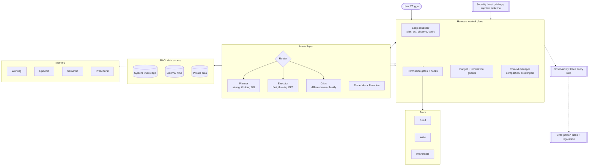

---

## 1. Model Layer: thinking, tooling, routing

### 1.1 Role-based routing

One model for everything is the most common mistake. Split by role, then route by signal.

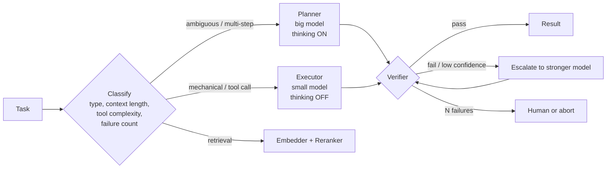

| Role | Model type | Thinking | Why |
|---|---|---|---|
| Planner | Strongest | ON | Decomposition, ambiguity |
| Executor | Fast/small | OFF | Cheap, low latency tool calls |
| Critic | Different family | ON | Avoids correlated errors |
| Embedder / Reranker | Specialized | n/a | Retrieval quality |
| Tool-call specialist | Tool-tuned | OFF | Fewer malformed calls |

### 1.2 Routing rules

- **Cascade:** small model first, escalate on verifier failure, low confidence, or N retries.
- **Signals:** task type, context length, schema complexity, prior failure count.
- **Fallback and circuit breaker** per model/node.
- **Local multi-node:** model residency and swap cost usually dominate latency. Keep hot models resident and route to the node that already has the model loaded.

### 1.3 Thinking budget

- Treat thinking as a routed parameter, not a global switch.
- ON: planning, critique, ambiguous decisions. OFF: mechanical tool execution.
- Keep reasoning blocks in-loop if the model requires them. **Never write raw thinking into long-term memory.**

### 1.4 Tooling

- Use one standard format (e.g., OpenAI-style tool calls) across all backends.
- Add schema-constrained decoding to reduce malformed calls.
- Classify every tool: **read / write / irreversible** (drives permission gates).
- Return **structured errors** that tell the model how to fix the call.
- Truncate or summarize large results before they re-enter context.
- Past ~20 tools, load tools on demand (tool search).
- Keep the prompt prefix stable to maximize prefix/KV cache hits.

---

## 2. RAG: system and external data access

### 2.1 Three planes, three rule sets

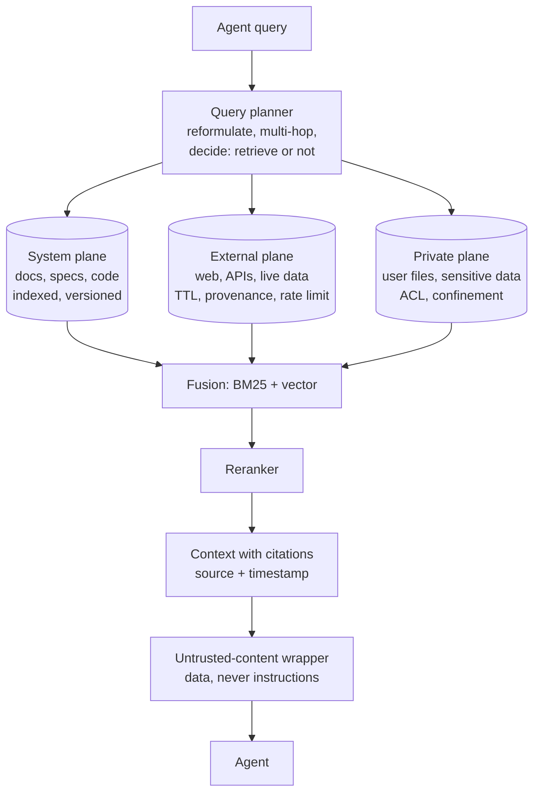

| Plane | Content | Key requirement |
|---|---|---|
| System | Docs, specs, code, configs | Indexed, versioned |
| External / live | Web, APIs, market data | TTL, provenance, rate limits |
| Private | User files, sensitive data | ACL, confinement to specific agents |

### 2.2 Common gaps

- **Agentic retrieval:** the agent reformulates, goes multi-hop, and can decide not to retrieve.
- **Hybrid retrieval:** BM25 + vector + reranker, with contextual chunking.
- **Structured sources:** text-to-SQL or graph for tabular/relational data; do not force everything into vectors.
- **Citations end to end:** source and timestamp survive into the final answer.
- **Retrieval eval:** golden query set, recall@k, rerun on every index or chunking change.
- **Injection isolation:** retrieved text is data. It must not be able to issue instructions.

---

## 3. Harness and Looping

### 3.1 The core loop

The loop is **act, observe, verify, update**, not just act and observe.

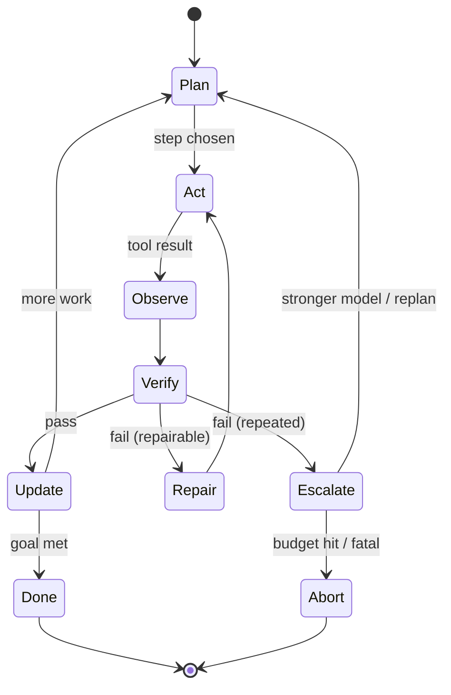

### 3.2 Control-plane checklist

| Component | What it does |
|---|---|
| **Termination** | Max steps, token/time/cost budget, no-progress detection, repetition detection (same tool + args N times) |
| **Verification** | Deterministic check first (tests, schema, assertions); LLM judge from a different model second |
| **Checkpoint / resume** | Append-only event log; every run is replayable and resumable |
| **Context management** | Compact at a threshold, clear old tool results, sub-agents return summaries not transcripts |
| **Orchestration** | Orchestrator + workers, parallel fan-out for independent subtasks, isolated context per worker |
| **Permission gates** | Auto-approve reads, confirm writes, human approval for irreversible actions |
| **Hooks** | Pre/post tool-call: logging, policy checks, redaction |
| **Error taxonomy** | Retryable (timeout), repairable (bad args), fatal (permission), each with its own policy |
| **Interrupt / steer** | Inject guidance mid-run without restarting |

### 3.3 Permission tiers

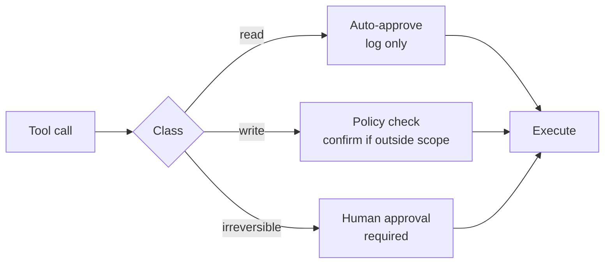

### 3.4 Multi-agent orchestration

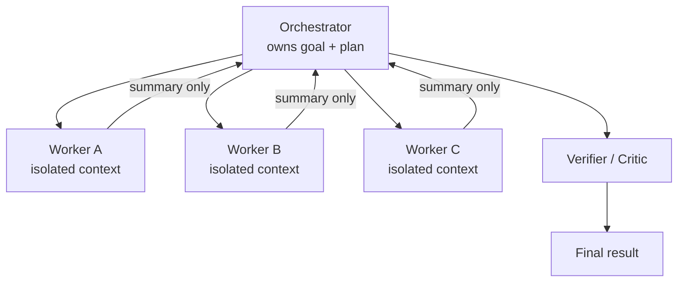

---

## 4. Memory

### 4.1 Five types

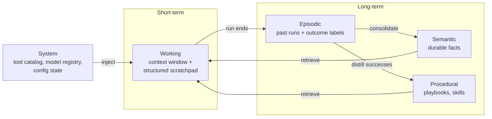

| Type | Holds | Store | Policy |
|---|---|---|---|
| Working | Goal, decisions, open questions, next step | Context + scratchpad | Re-inject after every compaction |
| Episodic | Trajectories + success/failure and why | Event log / DB | Label outcomes, TTL |
| Semantic | User, project, world facts | Markdown / KV / vector | Dedupe, supersede with history |
| Procedural | Reusable playbooks | Skill files | Distilled from verified successes |
| System | Tools, models, config | Registry | Versioned, read-mostly |

> Procedural memory is the most commonly missing type and the highest ROI.

### 4.2 Lifecycle (where most designs fail)

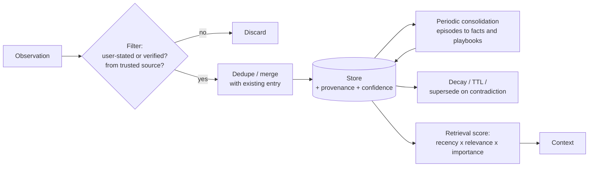

**Rules**
- **Write policy:** store only user-stated or verified facts. Never store model guesses.
- **Merge, do not append:** update the existing entry.
- **Forgetting:** TTL, decay, supersede-with-history on contradiction.
- **Scoping:** per-project and global namespaces.
- **Provenance + confidence** on every entry.
- **Poisoning defense:** untrusted content never writes to memory directly.
- **Human-readable store:** markdown files keep memory auditable and editable.

---

## 5. Cross-Cutting Planes

### 5.1 Eval and self-improvement loop

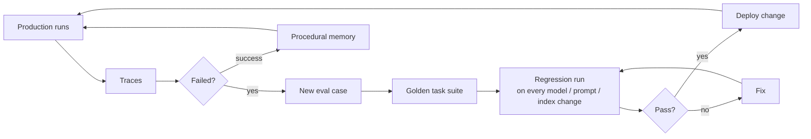

- Score **trajectories**, not just final answers (steps, cost, tool misuse).
- Without a regression suite, every routing or memory change is blind.

### 5.2 Observability

- One trace per step: model, tokens, latency, tool args and results, verifier verdict.
- Replay any run from the event log.
- Cost ledger per task and per model.

### 5.3 Security: the lethal trifecta

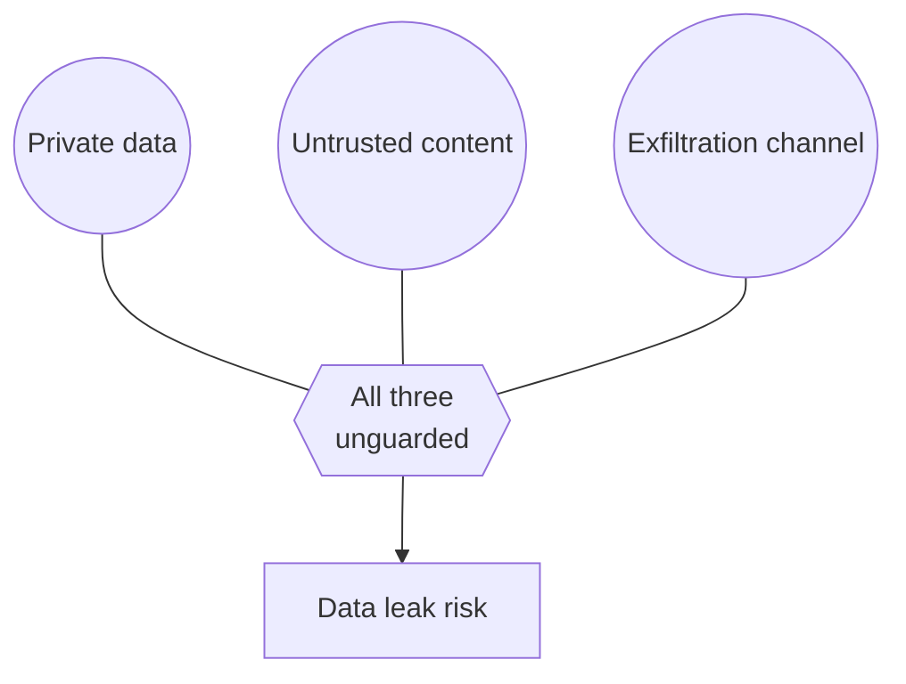

Never let all three coexist in one agent without a gate. Remove at least one leg: confine private data to a worker with no network, strip untrusted content of instruction authority, or require approval on outbound calls.

Also: least-privilege tools, secrets kept outside context, redaction hooks.

---

## 6. Maturity Checklist

Mark each item as Present / Partial / Missing.

**Model**
- [ ] Role-based routing (planner, executor, critic)
- [ ] Cascade escalation on verifier failure
- [ ] Thinking budget routed per task
- [ ] Cross-family critic
- [ ] Schema-constrained tool calls
- [ ] Tools classified read/write/irreversible

**RAG**
- [ ] Hybrid retrieval + reranker
- [ ] Agentic (multi-hop, can skip) retrieval
- [ ] Structured source access (SQL/graph)
- [ ] Citations with source + timestamp
- [ ] Retrieval eval (recall@k)
- [ ] Injection isolation

**Harness**
- [ ] Step/token/time/cost limits
- [ ] No-progress and repetition detection
- [ ] Verification step in the loop
- [ ] Append-only event log + resume
- [ ] Context compaction + scratchpad
- [ ] Permission tiers + hooks
- [ ] Error taxonomy
- [ ] Mid-run steering

**Memory**
- [ ] All five types present
- [ ] Write policy (stated/verified only)
- [ ] Dedupe/merge
- [ ] Consolidation job
- [ ] Forgetting / supersede
- [ ] Provenance on entries
- [ ] Poisoning defense

**Cross-cutting**
- [ ] Golden eval suite + regression
- [ ] Full tracing + replay
- [ ] Cost ledger
- [ ] Trifecta check
- [ ] Failures become eval cases

---

## 7. Build Order (highest leverage first)

```mermaid
flowchart LR
    S1[1. Trace + event log<br/>termination + budget] --> S2[2. Verifier +<br/>small golden eval]
    S2 --> S3[3. Context compaction<br/>+ scratchpad]
    S3 --> S4[4. Memory lifecycle<br/>write, merge, forget]
    S4 --> S5[5. Hybrid retrieval<br/>+ retrieval eval]
    S5 --> S6[6. Cascade routing<br/>+ cross-family critic]
    S6 --> S7[7. Permission tiers<br/>+ injection isolation]
    S7 --> S8[8. Procedural memory<br/>+ self-improvement loop]
```

**Why this order:** steps 1 and 2 make everything after them measurable. Without traces and evals, routing, memory, and retrieval changes cannot be judged.
